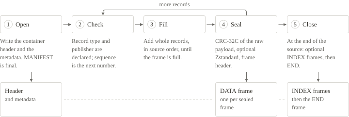
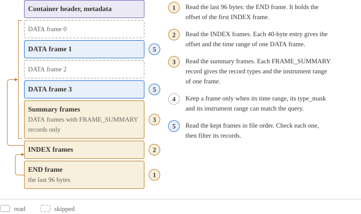
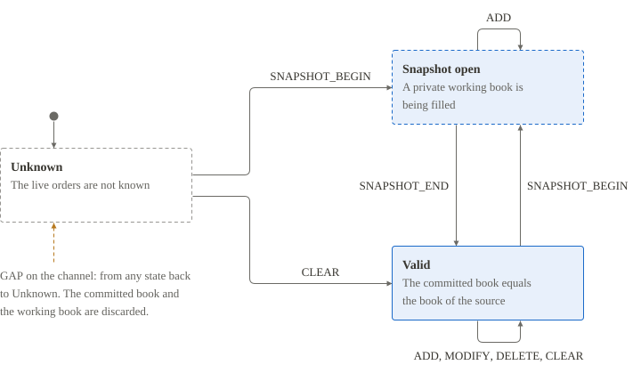
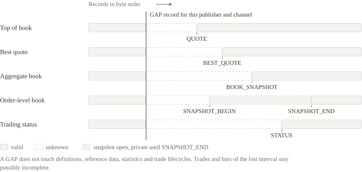

# How it works

NWT Binary Format stores market data and reference data as fixed-layout records inside checksummed frames. This page explains the format with diagrams: the path from a source to a reader, the file from its first byte to its last, one frame, one record, the record types and the keys that join them, and the steps a writer and a reader follow. Read it first if the format is new to you. Every section links to the page that gives the exact rules.

## From source to reader

A converter maps the rows of a source file to records, and a writer packs the records into one container. The same container serves as a file and as a live stream. A reader validates the container, decodes it in full, or reads only the frames that a query needs.


[Use NWT in practice](USE-CASES.md) · [The nwt command](TOOLS.md) · [Implementation guide](IMPLEMENTATION-GUIDE.md)

## Why the format looks like this

Four choices explain most of the format.

- **Fields have a fixed width and a fixed place.** The price of a trade is always the 8 bytes at offset 48 of its record. A reader goes straight to a value and never searches for a separator.
- **Numbers are integers scaled by 10⁹.** A price of 177.03 is stored as the integer 177,030,000,000. Decimal fractions stay exact, which binary floating point does not promise.
- **Records are packed into frames.** A frame is checked, compressed and skipped as one piece. A damaged part of a file does not spoil the rest, and a reader passes over the frames it does not need.
- **A file can carry an index.** The index lists every frame with its position and its time range, so a query opens only the frames that can hold an answer.

The second choice is easy to see in any Python prompt. The first line adds two prices as binary floating point, the second adds the same prices as scaled integers:

```python
print(0.1 + 0.2)
print(100_000_000 + 200_000_000)
```

```text
0.30000000000000004
300000000
```

The integer result is exactly 0.3 × 10⁹. The sections below show the other three choices at work: a record byte by byte, a frame, and a query that reads part of a file.

[Specification: Design principles](specification/file-structure.md#design-principles) · [Use NWT in practice](USE-CASES.md)

## One file, front to back

A container starts with a 64-byte header and the metadata. The metadata holds the `MANIFEST`, which declares every publisher and every record type of the file, and the optional `PROVENANCE`. Everything after the metadata is a sequence of frames. `DATA` frames carry the records, optional `INDEX` frames list the `DATA` frames, and one 96-byte `END` frame closes the container.


[Specification: File structure](specification/file-structure.md) · [Specification: Container header](specification/container-header.md) · [Specification: Metadata](specification/metadata.md)

## Frames

A frame is the unit of integrity and the unit of compression. Its 64-byte header states the kind of the frame, the codec and the sizes of the payload, and it carries two CRC-32C values: one over the header and one over the raw payload. The payload of a `DATA` frame is stored as it is or as one Zstandard frame, so a reader decodes each frame on its own. A reader trusts a record only after the frame that holds it passes both checks.


[Specification: Frames](specification/frames.md) · [Specification: Compression and integrity](specification/compression-and-integrity.md)

## Records

Every record starts with the same 48-byte header: its length and type, its publisher, channel and instrument, two timestamps in nanoseconds and a sequence number. The fixed fields of the record type follow. Some record types end with a variable part: texts or order book levels. The fixed fields give its size, so a reader never scans for a terminator. Prices and quantities are 64-bit integers scaled by 10⁹.


[Specification: Record header](specification/record-header.md) · [Field reference](FIELD-REFERENCE.md) · [Record types](records/INDEX.md)

## From a value to bytes

This section follows one trade from the sample [equity-orders.nwt](files/samples/equity-orders.nwt) from its values to its bytes and back. The trade is the record with sequence 18: 180 shares at 177.03, with the seller as the aggressor.

The JSON Lines view of the sample shows the values. Every number is the stored integer, written as a decimal string:

<!-- nwt-file: fixtures/real-market/equity-orders.jsonl lines=18-18 -->

The first ten fields are the record header. The price 177.03 is stored as 177030000000 and the quantity 180 as 180000000000, because both are scaled by 10⁹. The timestamps count nanoseconds since 1970-01-01 UTC, so 1758009600256830296 is 2025-09-16 08:00:00.256830296.

This program takes the same record out of the sample and prints every field with its offset and its bytes. Run it from the kit root:

```bash
mkdir -p work
```

```python
import sys
sys.path.insert(0, "examples/python")
import nwt_example as nwt

with open("fixtures/real-market/equity-orders.nwt", "rb") as f:
    frames = nwt.open_reader(f).frames()
    # record_type is the 2-byte field at offset 4 of every record; 1 is TRADE
    raw = next(r for _, records in frames for r in records if nwt.get(r, 4, 2) == 1)

record = nwt.decode_record(raw)
offset = 0
for field in nwt.SCHEMA["header"] + nwt.S[1]["fields"]:
    width = field["bytes"]
    name = field["name"]
    print(f"{offset:2}  {raw[offset:offset + width].hex():16}  {name} = {record['fields'][name]}")
    offset += width

assert nwt.encode_record(record) == raw
open("work/trade.bin", "wb").write(raw)
```

```text
 0  58000000          record_bytes = 88
 4  0100              record_type = 1
 6  01                schema_version = 1
 7  00                flags = 0
 8  02000000          publisher_id = 2
12  00000000          channel_id = 0
16  932d000000000000  instrument_id = 11667
24  58eb08c76ab46518  ts_event = 1758009600256830296
32  2a6b0bc76ab46518  ts_recv = 1758009600256994090
40  1200000000000000  sequence = 18
48  806dcf3729000000  price = 177030000000
56  0008d6e829000000  quantity = 180000000000
64  0100000000000000  trade_id = 1
72  0000000000000000  original_sequence = 0
80  01                action = 1
81  02                aggressor = 2
82  0000              conditions = 0
84  00000000          reserved = 0
```

The record is 88 bytes: 48 bytes of header and 40 bytes of trade fields. Every integer is little-endian, so its lowest byte comes first: `58000000` is 0x58, which is 88. The program finds the trade by looking at offset 4 of each record, without decoding anything else.

The function of the Python reference codec that packs these fields is short. It walks the field list of the schema and writes each value with the width and the sign that the schema gives:

<!-- nwt-file: examples/python/nwt_example.py lines=81-89 -->

The program saved the 88 bytes as `work/trade.bin`. The `decode-record` command of the reference codec reads them back:

```bash
python3 examples/python/nwt_example.py decode-record work/trade.bin
```

```text
1.record_bytes=88
1.record_type=1
1.schema_version=1
1.flags=0
1.publisher_id=2
1.channel_id=0
1.instrument_id=11667
1.ts_event=1758009600256830296
1.ts_recv=1758009600256994090
1.sequence=18
1.price=177030000000
1.quantity=180000000000
1.trade_id=1
1.original_sequence=0
1.action=1
1.aggressor=2
1.conditions=0
1.reserved=0
```

[Field reference](FIELD-REFERENCE.md) · [Implementation guide: Encode one record](IMPLEMENTATION-GUIDE.md#encode-one-record) · [Market data samples](REAL-DATA-MARKET.md)

## How the record types relate

The 22 record types form three groups. `INSTRUMENT_DEF` and the six reference record types describe instruments and venues. The twelve market record types say what happened to one instrument, and each needs an `INSTRUMENT_DEF` for that instrument earlier in the file. The three stream record types describe the stream itself. Above all of them stands the `MANIFEST`, which declares the publishers and the record types before the first record.


Records about the same instrument share the pair `publisher_id` and `instrument_id`. The pair joins a market record to the definition of its instrument, and the definition to the option terms, the listing, the symbols, the security record and the corporate actions of that instrument. A `VENUE_DEF` is keyed by its market identifier code.


[Specification: Record types](specification/record-types.md) · [Field reference](FIELD-REFERENCE.md) · [Glossary](GLOSSARY.md)

## Writing a file

A writer emits the container header and the metadata first. After that the `MANIFEST` cannot change. It takes the records in the order of the source, checks each one and collects whole records into a frame. When the frame is full, the writer computes the CRC-32C of the raw payload, optionally compresses the payload with Zstandard, and writes the frame. The `INDEX` frames and the `END` frame close the container.



[Implementation guide: Write a file](IMPLEMENTATION-GUIDE.md#write-a-file) · [Specification: Writer obligations](specification/reader-and-writer-requirements.md#writer-obligations)

## Reading a file

A reader of a whole file checks the container header and the metadata once. Then it repeats the same steps for every frame: check the frame header, read the payload, decompress it when the codec is Zstandard, and check the CRC-32C of the raw payload. The kind of the frame decides what follows: a `DATA` frame delivers records, an `INDEX` frame is compared with the frames already read, and the `END` frame ends the file. A failed check stops the read.


[Implementation guide: Read a file](IMPLEMENTATION-GUIDE.md#read-a-file) · [Specification: Incremental decoding](specification/reader-and-writer-requirements.md#incremental-decoding) · [The nwt command](TOOLS.md)

## Reading only what you need

A store file is an ordinary container written with large compressed frames, an index and one `FRAME_SUMMARY` record for every frame. A reader starts at the `END` frame, reads the index and the summaries, and learns the time range, the record types and the instrument range of every frame. It then reads only the frames that can hold a match. The result holds the same records in the same order as a full scan with the same filter. It does not include the definitions and the book state that the skipped frames built, so it is a partial read.



[Store profile](STORE.md) · [Specification: Store profile](specification/store-profile.md) · [Size and speed](PERFORMANCE.md)

## How the file works as a database

A store file answers a query the way a database does: it consults a catalogue first and reads only the blocks the catalogue points to. The blocks are the `DATA` frames. The catalogue is the `FRAME_SUMMARY` records and the `INDEX` frame, which say where every frame starts, which time range it covers, and which record types and instruments it holds. The `END` frame is always the last 96 bytes of the file, and it tells the reader where the `INDEX` begins.


The diagram shows a real file. The `repack` command writes it from the sample [equity-quotes.nwt](files/samples/equity-quotes.nwt), and `--frame-bytes 65536` makes the frames small enough to get four of them:

```bash
python3 tools/nwt.py repack fixtures/real-market/equity-quotes.nwt work/equity-quotes.store.nwt --frame-bytes 65536
```

The frame table of `inspect` lists the parts of the file with their offsets:

```bash
python3 tools/nwt.py inspect work/equity-quotes.store.nwt | tail -n 13 | head -n 8
```

```text
frame seq kind codec offset stored_bytes raw_bytes records min_event_ns max_event_ns
0 DATA 1 2120 9605 65480 652 1758006306677514564 1758009758289670910
1 DATA 1 11792 9221 65520 652 1758009758289672303 1758009809048757997
2 DATA 1 21080 8735 65496 647 1758009809049258043 1758009844980010260
3 DATA 1 29880 7493 52752 526 1758009844980046859 1758009883915993953
4 DATA 1 37440 102 416 4 - -
5 INDEX 0 37608 200 200 0 - -
6 END 0 37872 32 32 0 - -
```

Frames 0 to 3 hold the records, and frame 4 is the summary frame. This query asks for the `TRADE_QUOTE` records of one minute and prints the first of them:

```bash
python3 tools/nwt.py query work/equity-quotes.store.nwt --type TRADE_QUOTE --from 2025-09-16T08:03:00Z --to 2025-09-16T08:04:00Z --pretty | head -n 1
```

```text
# partial: earlier definitions and book state are not included
{"type_name":"TRADE_QUOTE","record_bytes":"120","record_type":"18","schema_version":"1","flags":"0","publisher_id":"2","channel_id":"0","instrument_id":"11667","ts_event":"2025-09-16T08:03:04.530356100Z","ts_recv":"2025-09-16T08:03:04.530521940Z","sequence":"734","price":"177.290000000","quantity":"78.000000000","trade_id":"0","bid_price":"177.260000000","ask_price":"177.300000000","bid_quantity":"20.000000000","ask_quantity":"1100.000000000","bid_order_count":"1","ask_order_count":"2","aggressor":"0","conditions":"0"}
```

The next program runs the same query through a function that records every read, so the output shows what the reader fetched:

```python
import sys
sys.path[:0] = ["tools", "examples/python"]
import nwt_example
import nwt as tool

data = open("work/equity-quotes.store.nwt", "rb").read()
reads = []

def read_at(offset, n):                  # the only way the reader touches the file
    reads.append((offset, n))
    return data[offset : offset + n]

reader = nwt_example.Reader(read_at, len(data))
found = list(tool.select(reader, types=[18],     # 18 is TRADE_QUOTE
                         t0=tool.parse_time("2025-09-16T08:03:00Z"),
                         t1=tool.parse_time("2025-09-16T08:04:00Z")))
for offset, n in reads:
    print(f"read {n:5} bytes at offset {offset}")
print(f"{len(found)} records; {sum(n for _, n in reads)} of {len(data)} bytes")
```

```text
read    64 bytes at offset 0
read  2056 bytes at offset 64
read    64 bytes at offset 37872
read    32 bytes at offset 37936
read    64 bytes at offset 37608
read   200 bytes at offset 37672
read    64 bytes at offset 37440
read   104 bytes at offset 37504
read    64 bytes at offset 11792
read  9224 bytes at offset 11856
read    64 bytes at offset 21080
read  8736 bytes at offset 21144
228 records; 20736 of 37968 bytes
```

The reader opens the container header and the metadata, then `END`, the `INDEX` frame and the summary frame, each as a 64-byte frame header followed by its payload. After that it reads frames 1 and 2, whose time ranges overlap the requested minute. Frame 0 ends before 08:03 and frame 3 starts after 08:04, so offsets 2120 and 29880 never appear in the list. The stored sizes and the offsets depend on the version of the Zstandard library.

[Store profile](STORE.md) · [The nwt command](TOOLS.md) · [Size and speed](PERFORMANCE.md)

## Keeping state and recovering from gaps

A consumer that builds order books, quotes or a trade tape applies the records in byte order and keeps state for each publisher, channel and instrument. An order-level book starts as unknown. It becomes valid after an `MBO` `CLEAR` or after a snapshot that runs from `SNAPSHOT_BEGIN` to `SNAPSHOT_END`.



A `GAP` record reports that the producer lost data from the source. It makes the order books, the quotes and the trading status of its publisher and channel unknown. Each of them becomes valid again when its own record arrives. An aggregate book is also valid again after a `BOOK_DELTA` with action `CLEAR` and `side` 0, and an order-level book after an `MBO` `CLEAR`. A damaged or missing frame is a different event: it is a transfer failure, and the reader stops.



[State and recovery](STATE-AND-RECOVERY.md) · [Specification: Ordering, gaps, snapshots and replay](specification/ordering-gaps-snapshots-and-replay.md)

## Files to open

- [all-records.nwt](files/samples/all-records.nwt) and [all-records.zst.nwt](files/samples/all-records.zst.nwt): the conformance files. Each holds 47 records of 21 record types (every type except `FRAME_SUMMARY`), the first in raw frames and the second in Zstandard frames.
- [records.json](files/records.json): the machine-readable schema of all 22 record types.
- [nwt-binary-format-kit.zip](files/nwt-binary-format-kit.zip): the whole kit, with the documents, the schema, the reference codecs, the tools and the fixtures.

[Downloads](DOWNLOADS.md) · [Specification](SPECIFICATION.md) · [Field reference](FIELD-REFERENCE.md)
