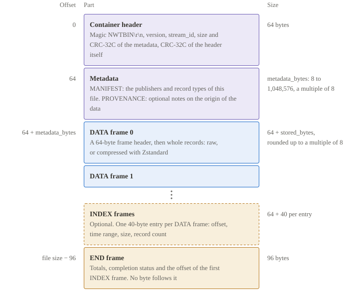
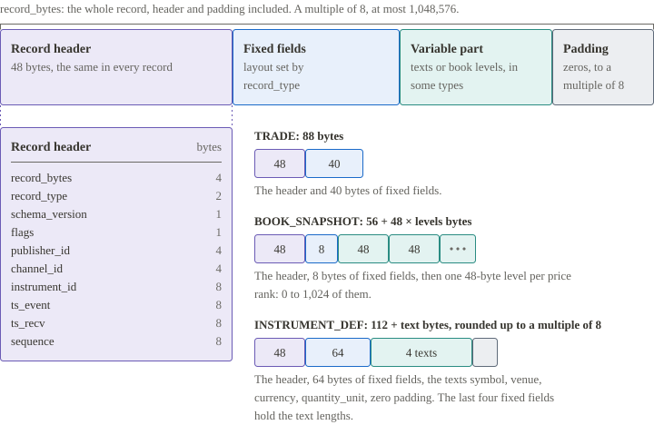

# Specification

This specification defines the NWT Binary Format: the bytes of a container, its metadata, its frames and its 22 standard record types, and the rules that a reader and a writer follow. It is the normative reference for engineers who implement a reader, a writer or a data pipeline for market data and reference data.

[How it works](HOW-IT-WORKS.md) introduces the format with diagrams. The [Field reference](FIELD-REFERENCE.md) describes every field of every record type, and [Examples by record type](FEED-COOKBOOK.md) shows each record type as bytes. The [Implementation guide](IMPLEMENTATION-GUIDE.md) covers building a reader and a writer. [State and recovery](STATE-AND-RECOVERY.md) covers the state a consumer keeps.

## Conformance

### Requirement keywords

This specification uses no special requirement keywords. It states each rule as a fact about the format, in the present tense, and a rule has no exceptions. A conforming writer produces only containers in which every rule holds, and a conforming reader checks the rules of the capabilities it claims and reports an error for input that breaks one. A recommendation is introduced by "we recommend", and an implementation can depart from it for a documented operational reason.

### Scope

NWT is a container of framed, checksummed records. It carries normalized market data and reference data, and it has private record types for other event data. The same bytes serve a live byte stream and a file.

The format provides deterministic decoding, bounded memory use, several record types in one container, incremental streaming, nanosecond timestamps, exact decimal values and corruption detection.

The format does not define:

- datagram delivery;
- a socket handshake, subscription negotiation or authentication messages;
- distributed consensus or exactly-once application processing;
- arbitrary-precision decimals, or a decimal scale other than 10⁻⁹;
- encryption, signatures or authenticated containers;
- dictionary compression;
- a source cursor for replay;
- an index of definitions or of book state;
- corrections that span containers;
- metadata that changes inside a container.

`OPTION_DEF`, `SECURITY_DEF` and `CORPORATE_ACTION` carry the option, security-master and corporate-action fields listed in their sections. Data beyond those fields, such as full terms and conditions or entitlement data, needs a private schema.

### Capabilities

A conformance claim names the capabilities it covers.

| Capability | Requirement |
|---|---|
| Core reader | Container, metadata, codec 0, frame integrity, record headers, `INDEX` and `END` |
| Core writer | Emits fully valid containers and the schemas it advertises |
| Zstandard reader or writer | Codec 1. Optional, and advertised explicitly |
| Store reader or writer | The [store profile](#store-profile): `INDEX`, `FRAME_SUMMARY`, the optional `ordering` property and selective frame reads |
| Market-data reader | The rules of every standard schema in its supported subset |
| Lossless relay | Preserves all record bytes, including optional records it does not know |
| Semantic consumer | Refuses required schemas it does not support and reports the optional data it skips |

- A core reader can inspect records without interpreting their payloads.
- Successful framing is not market-data conformance. A reader that checks only the binary shape does not enforce the trade and book rules, the definition rules or the state rules.
- A reader that supports only codec 0 is conformant, but it cannot read every NWT file.

## File structure

A container is one byte sequence: a container header, metadata, a series of frames, and one `END` frame that closes it. `DATA` frames carry the records. The layout is the same for a file and for a live stream.



```text
Container
  container header     64 bytes
  metadata             TLV elements, each padded to 8 bytes
  DATA frame 0
  DATA frame 1
  ...
  INDEX frames         optional, contiguous
  END frame            96 bytes

DATA frame
  frame header         64 bytes
  stored payload       raw records, or one Zstandard frame
  zero padding         to an 8-byte boundary

Raw DATA payload
  record               48-byte record header, body, zero padding
  record
  ...
```

| Part | Bytes | Content |
|---|---|---|
| [Container header](#container-header) | 64 | Magic, version, metadata size, stream identifier, checksums |
| [Metadata](#metadata) | 8 to 1,048,576 | `MANIFEST` and the optional `PROVENANCE` |
| [`DATA` frames](#data-frames) | 64 + align8(`stored_bytes`) each | Records |
| [`INDEX` frames](#index-frames) | 64 + align8(`stored_bytes`) each | Optional. One 40-byte entry for each `DATA` frame |
| [`END` frame](#end-frame) | 96 | Totals, completion status and the offset of the first `INDEX` frame |

### Terms

- **Container.** One complete NWT byte sequence, from the container header to the `END` frame. One file or one stream holds one container.
- **Metadata.** The TLV elements between the container header and the first frame.
- **Manifest.** The content of the `MANIFEST` element: the dataset, the publishers and the schemas of the container.
- **Frame.** A checksummed unit of the container. Its kind is `DATA`, `INDEX` or `END`. A frame kind is not a record type.
- **Record.** One message of one record type inside a `DATA` frame.
- **Schema.** A record type together with a schema version: one wire layout and its rules. A feed type of a data source maps to a record type.
- **Writer** and **reader.** The implementations that encode and decode a container.
- **Producer** and **consumer.** The systems that own them. The producer decides what the writer emits and owns the identifier namespaces. The consumer applies the decoded records.

### Structural rules

- The container has no global compression wrapper. Each `DATA` frame is decodable on its own after the metadata is known.
- A record never crosses a frame boundary.
- Metadata is immutable for a container. Instrument definitions that change over time are records.
- Every schema and every publisher is declared in the metadata before a record refers to it.
- The stored length of a frame excludes its outer padding. The length of a record includes its internal padding. Offsets in an index refer to frame headers, never to record starts.
- The recommended file name suffix is `.nwt`, whether or not frames are compressed. The suggested private media type is `application/x-nwt`.

### Design principles

1. **Fixed layouts.** Every standard record has a fixed size or a size computed from stated lengths. A reader never scans for a terminator.
2. **Frames are the unit of integrity.** A frame carries one CRC over its raw payload. No record is trusted before its frame passes.
3. **Byte order is delivery order.** Records are never sorted. Definitions, snapshots and trade lifecycles depend on the order in which they arrive.
4. **Exact numbers.** Prices and quantities are integers scaled by 10⁻⁹. There is no floating point on the wire.
5. **Nothing is inferred.** A fact the producer does not know is null or "unknown". A consumer does not derive it from a symbol.
6. **One container for transport and storage.** A [store file](#store-profile) is an ordinary container written with particular choices. Nothing is added to the container to support it.

Frames give batching, bounded decompression and corruption boundaries. They cost 64 bytes per batch and can add buffering latency. The 48-byte record header carries both timestamps, a 64-bit instrument ID and a sequence number in every record.

## Data types and conventions

### Representation

- All integers are little-endian. Signed integers use two's complement.
- `u8`, `u16`, `u32`, `u64` and `i64` have their stated widths. `bytes[N]` is exactly N bytes.
- There are no implicit padding bytes of a compiler. Offsets in layout tables are byte offsets from the start of the structure.
- Reserved fields and padding are zero. A strict reader rejects a nonzero value.
- Standard record payloads contain no floating-point values and no variable-length integers.

### Alignment

`align8(n) = (n + 7) & ~7`, computed with checked arithmetic.

- Metadata elements, frame starts and the starts of uncompressed records are aligned to 8 bytes relative to their enclosing buffer.
- Compressed bytes have no record alignment until they are decompressed.
- Alignment in the file does not establish memory alignment in an arbitrary network buffer.

### Text

- Text is well-formed UTF-8. It is not NUL-terminated.
- A text length counts bytes, not characters.
- An embedded NUL and invalid UTF-8 are prohibited in text fields.
- Identifiers are case-sensitive and compared byte for byte. We recommend that producers use NFC normalization.

### Time

A timestamp is a `u64` count of nanoseconds since 1970-01-01T00:00:00 on the POSIX time scale. Leap seconds are not counted as additional seconds.

- The null timestamp is `UINT64_MAX`. Zero is the epoch, not null.
- A timestamp before the epoch cannot be represented.
- Time from a source that uses another clock scale is converted to this scale before encoding. A leap-smear policy, if one is used, is described in the metadata.
- `ts_event` is the source event time, or null when it is unavailable.
- `ts_recv` is the capture time at the producer, or null when it is unavailable.
- The two times need not be ordered. A consumer cannot infer network delay from them unless the relationship between the clocks is known.
- A late event keeps its original timestamp.

### Decimal values and null values

| Logical type | Wire type | Meaning | Null |
|---|---|---|---|
| Price | `i64` | Integer × 10⁻⁹, in the currency of the definition | `INT64_MIN` |
| Quantity | `u64` | Integer × 10⁻⁹, in the quantity unit of the definition | `UINT64_MAX` |
| Multiplier | `i64` | Integer × 10⁻⁹ | `INT64_MIN` |
| Count | `u32` | Integral count | `UINT32_MAX` |
| Identifier | Stated unsigned width | Opaque value in a namespace | Stated with each field |

The null values are `INT64_MIN` = −9,223,372,036,854,775,808, `UINT64_MAX` = 18,446,744,073,709,551,615 and `UINT32_MAX` = 4,294,967,295. An all-zero value is not a null.

- The price 123.45 is encoded as `123450000000`. The quantity 10 is encoded as `10000000000`.
- A price of zero and a negative price are valid. A non-null quantity is nonnegative.
- The largest price is about 9.22 billion currency units. The largest quantity is about 18.45 billion units.
- A producer rejects a value that is out of range, or uses a different registered schema. Silent clamping, wrapping and rounding are not allowed.
- An input with more than nine fractional digits needs an explicit conversion policy outside this format. A conversion that rounds reports the loss to the caller and describes it in `PROVENANCE`.
- For arithmetic, we recommend checked intermediates wider than 64 bits.

### Identifiers

- A publisher ID is a `u32`. An instrument ID, an order ID and a trade ID are `u64`.
- Publisher 0 and instrument 0 are reserved for the container and system scope, where a record type allows them. Other identifiers can use their full range unless a schema says otherwise.
- An instrument is identified by `(dataset, publisher_id, instrument_id)`, not by its symbol alone.
- The producer owns that namespace. Within the history of one dataset, an instrument ID is never reused for a different economic instrument.

## Container header

The container starts at byte 0 with this 64-byte header.

| Offset | Field | Type | Bytes | Meaning |
|---:|---|---|---:|---|
| 0 | `magic` | bytes | 8 | `4e 57 54 42 49 4e 0d 0a`, the ASCII text `NWTBIN\r\n` |
| 8 | `major` | u16 | 2 | 1 |
| 10 | `minor` | u16 | 2 | 0 or 1, by the rule below |
| 12 | `header_bytes` | u16 | 2 | 64 |
| 14 | `flags` | u16 | 2 | 0 |
| 16 | `metadata_bytes` | u32 | 4 | Total size of the metadata, including padding |
| 20 | `metadata_crc32c` | u32 | 4 | CRC of all metadata bytes, including padding |
| 24 | `stream_id` | bytes | 16 | Opaque nonzero 128-bit identifier |
| 40 | `created_ns` | u64 | 8 | Creation time, or null |
| 48 | `reserved` | u64 | 8 | 0 |
| 56 | `header_crc32c` | u32 | 4 | CRC of the 64 header bytes with this field set to zero |
| 60 | `reserved` | u32 | 4 | 0 |

**Version.**

- `minor` is 1 when the manifest declares at least one of the standard record types 10–22, and 0 otherwise. Declaring only private types (32,768–65,534) does not make it 1.
- A writer sets `minor` by this rule.
- A reader accepts 0 and 1. It rejects a header whose `minor` disagrees with the declared types.

**Metadata size.**

- `metadata_bytes` is a multiple of 8, at least 8 and at most 1,048,576.
- The first frame begins at offset `64 + metadata_bytes`.
- A reader validates the header before it trusts the metadata length.
- The CRC parameters are in [Compression and integrity](#compression-and-integrity).

**Stream identifier.**

- `stream_id` is a byte string. It is not a little-endian integer and not a GUID structure of a programming language. Its text form is 32 lower-case hexadecimal characters in byte order.
- It identifies one immutable container byte sequence, including metadata and frames. A retransmission of the same bytes keeps it.
- A new connection that produces different framing, a filtered export, a repaired file and a recompressed file each get a new ID.
- We recommend generating it with a cryptographically strong random generator.
- A writer that regenerates the same bytes deterministically, such as a generator of conformance files, can use a fixed ID.

## Metadata

### TLV encoding

The metadata is a sequence of TLV elements. Each element has an 8-byte header, a value and zero padding.

| Offset | Field | Type | Bytes | Meaning |
|---:|---|---|---:|---|
| 0 | `type` | u16 | 2 | Element type |
| 2 | `flags` | u16 | 2 | Bit 0 is `REQUIRED`; other bits are zero |
| 4 | `value_bytes` | u32 | 4 | Size of the value, without header and padding |
| 8 | value | bytes | `value_bytes` | The value, then zero padding to a multiple of 8 |

- The padding is `align8(8 + value_bytes) - (8 + value_bytes)` zero bytes.
- The elements fill `metadata_bytes` exactly. Nothing follows the last element.
- A reader rejects an unknown element whose `REQUIRED` bit is set. It can skip an unknown optional element after it validates the bounds and padding of that element.
- Types 0 and 65,535 are invalid. Types 1–32,767 are standard. Types 32,768–65,534 are private.
- Every type appears at most once. A duplicate type is invalid, including a duplicate of an unknown type.

| Type | Name | Requirement |
|---:|---|---|
| 1 | `MANIFEST` | Exactly one. The `REQUIRED` bit is set |
| 2 | `PROVENANCE` | Optional JSON object. The `REQUIRED` bit is clear |
| 32,768–65,534 | Private extension | Defined outside this specification. The `REQUIRED` bit states whether a reader needs to support it |

### MANIFEST

The value is a UTF-8 JSON object without a byte order mark.

- A reader rejects duplicate object keys, NaN, infinity, malformed Unicode and JSON nested deeper than 16 levels.
- The size of the manifest is bounded by the maximum metadata size.
- A JSON number in the manifest is an exact integer from 0 through 4,294,967,295. A value that needs more range is a string with a syntax that the schema defines.
- A reader can ignore an unknown object property. An unknown property does not change the interpretation of existing fields.

Required top-level fields:

| Field | Type | Rules |
|---|---|---|
| `dataset` | string | 1–255 UTF-8 bytes. A stable namespace |
| `producer` | string | 1–255 bytes. Name and version of the producer |
| `profile` | string | Exactly `market-data` or `generic-events` |
| `publishers` | array | Up to 4,096 entries with unique IDs |
| `schemas` | array | 1–4,096 entries with unique `(type, version)` pairs |
| `clock` | string | Exactly `posix-ns` |

Optional top-level field:

| Field | Type | Rules |
|---|---|---|
| `ordering` | string | `none`, `ts_event` or `instrument,ts_event`. Absent means `none` |

**Ordering.** `ordering` is a claim of the producer about the order of records in the container.

- `ts_event`: the non-null `ts_event` values are non-decreasing in byte order across the whole container. Records with a null `ts_event` are exempt.
- `instrument,ts_event`: the `instrument_id` values are non-decreasing in byte order, and within one `instrument_id` the non-null `ts_event` values are non-decreasing.
- A producer declares an ordering only when it holds. A validator checks the claim against a full scan. A false claim is an error.
- The property changes no wire meaning. A reader that does not use it ignores it.
- Binary search by time is valid only when a validated `ts_event` ordering is declared. See [`INDEX` frames](#index-frames).

**Publishers.** Each publisher object contains `id` (1–4,294,967,295), `name` (1–255 bytes) and `venue` (0–255 bytes).

- The publisher list may be empty only when every record uses the system scope.
- A venue is a name that the producer defines. It need not be a market identifier code.
- Every nonzero publisher in a record is declared.

**Schemas.** Each schema object contains `type` (1–65,534), `version` (1–255), `required` (boolean), `name` (1–255 bytes) and `spec_uri` (1–2,048 bytes).

- A standard schema uses version 1 and its name from [Record types](#record-types).
- `spec_uri` is `urn:nwt:spec:1.0` for record types 1–9 and `urn:nwt:spec:1.1` for record types 10–22.
- A private schema provides a stable URI that identifies its exact external specification. A URI is an identifier. It is not an instruction to fetch or execute code.
- The schema list is a declaration. It is not an embedded schema language.
- Every `(type, version)` that the container emits is declared, including optional ones. Declarations that no record uses are permitted.
- The value of `required` for each standard record type is given in [Scope and required schemas](#scope-and-required-schemas).

**Profiles.**

- `market-data` requires instrument definitions before use and the rules in [Record types](#record-types) and [Ordering, gaps, snapshots and replay](#ordering-gaps-snapshots-and-replay).
- `generic-events` permits system and private event schemas. The standard record types 1–7 and 10–19 are not allowed in it. It does not relax framing or sequencing.
- `GAP`, `SYSTEM`, `FRAME_SUMMARY`, `SECURITY_DEF` and `CORPORATE_ACTION` are permitted in either profile.

<!-- nwt-title: Example manifest -->
```json
{
  "dataset": "EXAMPLE.MARKET",
  "producer": "example-writer/3",
  "profile": "market-data",
  "clock": "posix-ns",
  "ordering": "ts_event",
  "publishers": [{"id": 1, "name": "Example Feed", "venue": "EXAMPLE"}],
  "schemas": [
    {"type": 1, "version": 1, "required": true, "name": "TRADE", "spec_uri": "urn:nwt:spec:1.0"},
    {"type": 6, "version": 1, "required": true, "name": "INSTRUMENT_DEF", "spec_uri": "urn:nwt:spec:1.0"},
    {"type": 15, "version": 1, "required": true, "name": "BOOK_DELTA", "spec_uri": "urn:nwt:spec:1.1"}
  ]
}
```

This manifest declares record type 15, so the container header has `minor` = 1.

### PROVENANCE

The value is a JSON object under the same text and nesting rules as `MANIFEST`.

- Recommended optional string properties: `source_format`, `source_version`, `converter`, `conversion_policy`, `clock_policy` and `license_reference`. Each string is at most 4,096 bytes.
- Credentials are not allowed in it.
- It is descriptive and cannot override the wire rules of this specification.

## Frames

Everything after the metadata is a sequence of frames. A frame is a 64-byte header, a payload and zero padding to an 8-byte boundary. The header states the kind of the frame, the codec and the size of the payload, and it carries the checksums.


### Frame header

Every frame begins with this 64-byte header.

| Offset | Field | Type | Bytes | Meaning |
|---:|---|---|---:|---|
| 0 | `magic` | bytes | 4 | `4e 57 46 31`, the ASCII text `NWF1` |
| 4 | `envelope_version` | u8 | 1 | 1 |
| 5 | `kind` | u8 | 1 | 1 `DATA`, 2 `INDEX`, 3 `END` |
| 6 | `codec` | u8 | 1 | 0 raw, 1 Zstandard |
| 7 | `flags` | u8 | 1 | 0 |
| 8 | `header_bytes` | u16 | 2 | 64 |
| 10 | `reserved` | u16 | 2 | 0 |
| 12 | `stored_bytes` | u32 | 4 | Payload bytes as stored or transmitted |
| 16 | `raw_bytes` | u32 | 4 | Payload bytes after decompression |
| 20 | `record_count` | u32 | 4 | Number of records in a `DATA` frame; otherwise 0 |
| 24 | `frame_seq` | u64 | 8 | Starts at 0 and increases by 1 for every frame of any kind |
| 32 | `min_event_ns` | u64 | 8 | Smallest non-null `ts_event` in a `DATA` frame |
| 40 | `max_event_ns` | u64 | 8 | Largest non-null `ts_event` in a `DATA` frame |
| 48 | `payload_crc32c` | u32 | 4 | CRC of the raw payload |
| 52 | `header_crc32c` | u32 | 4 | CRC of the 64 header bytes with this field set to zero |
| 56 | `reserved` | u64 | 8 | 0 |

- The total stored size of a frame is `64 + align8(stored_bytes)`.
- The padding after the payload is outside the compression and outside the payload CRC. A reader validates that it is zero.
- For codec 0, `stored_bytes` equals `raw_bytes`.
- `stored_bytes` and `raw_bytes` are each at most 16,777,216.
- Decompression produces exactly `raw_bytes` bytes.
- A reader rejects an unknown kind, an unknown envelope version, an unknown codec and nonzero flags.
- `frame_seq` never wraps.
- A frame has no optionality bit. A reader cannot skip a frame with an unsupported codec and claim complete decoding.

**Order of frames.** `DATA` frames precede all `INDEX` frames. Zero or more contiguous `INDEX` frames precede exactly one `END` frame. A `DATA` frame cannot follow an `INDEX` frame. An empty container is valid: metadata followed directly by `END`.

### DATA frames

A `DATA` frame contains one or more complete records.

- `record_count` is at least 1. It equals the number of records parsed, and it cannot exceed `floor(raw_bytes / 48)`.
- `raw_bytes` is at least 48, is a multiple of 8 and equals the sum of the record lengths.
- `min_event_ns` and `max_event_ns` cover every non-null `ts_event` in the frame, including control records.
- If every `ts_event` in the frame is null, both bounds are null. Otherwise both bounds are non-null and exact, with minimum ≤ maximum.
- A record with a null timestamp can share a frame with non-null bounds. A time filter handles such records separately. The bounds do not show that every record has a timestamp.

### INDEX frames

An `INDEX` frame uses codec 0, `record_count` = 0 and null timestamp bounds. Its payload is one or more 40-byte entries with no count prefix. The entry count is `raw_bytes / 40`, and `raw_bytes` is a positive multiple of 40.

| Offset | Field | Type | Bytes | Meaning |
|---:|---|---|---:|---|
| 0 | `data_frame_seq` | u64 | 8 | `frame_seq` of the `DATA` frame |
| 8 | `data_frame_offset` | u64 | 8 | Offset of that frame header from container byte 0 |
| 16 | `min_event_ns` | u64 | 8 | `min_event_ns` of that frame |
| 24 | `max_event_ns` | u64 | 8 | `max_event_ns` of that frame |
| 32 | `raw_bytes` | u32 | 4 | `raw_bytes` of that frame |
| 36 | `record_count` | u32 | 4 | `record_count` of that frame |

- If a container has `INDEX` frames, their concatenated entries list every `DATA` frame exactly once, in ascending `frame_seq` order, with values identical to the frame headers.
- A container can hold several `INDEX` frames to stay within the frame size maximum.
- An entry cannot refer to metadata, to an `INDEX` frame, to the `END` frame or to bytes outside the container.
- An empty container has no `INDEX` frames.

**Using the index.**

- The index selects candidate frames. It is not a checkpoint of state.
- Timestamp ranges of frames can overlap or go backward. Binary search by timestamp is invalid unless monotonic order is established separately, for example by a manifest `ordering` of `ts_event` that a validator has checked. See [MANIFEST](#manifest).
- A general reader examines all index ranges and reads the selected frames in their original order.
- A reader needs an explicit policy for records with null timestamps. Frame bounds do not identify every frame that holds one.
- A seek to a trade or a quote still needs the instrument definitions that precede it. `MBO` needs an earlier complete snapshot or `CLEAR` and every update after it.
- A consumer that seeks without that context labels its results as raw or partial. It cannot claim a reconstructed valid book.
- [`FRAME_SUMMARY`](#frame_summary) adds the record types and the instrument range of each frame. It does not carry state.

### END frame

The `END` frame uses codec 0, `record_count` = 0 and null timestamp bounds. Its payload is 32 bytes, so the frame is exactly 96 bytes.

| Offset | Field | Type | Bytes | Meaning |
|---:|---|---|---:|---|
| 0 | `first_index_offset` | u64 | 8 | Offset of the first `INDEX` frame, or 0 when there is none |
| 8 | `total_data_frames` | u64 | 8 | Number of `DATA` frames |
| 16 | `total_records` | u64 | 8 | Number of records in all `DATA` frames |
| 24 | `completion_status` | u32 | 4 | 0 normal, 1 aborted by the producer |
| 28 | `reserved` | u32 | 4 | 0 |

- The counts include optional records that a reader does not know. They match the container.
- A nonzero `first_index_offset` identifies the first `INDEX` frame, and every frame from there to `END` is an `INDEX` frame.
- The `frame_seq` of `END` equals the number of `DATA` and `INDEX` frames before it.
- No bytes follow `END` in one NWT object, not even another container. Concatenation needs an external bundle format or separate objects.

**Reading from the end.** A seekable reader can read the last 96 bytes to find the index. It validates `END` and every bound that `END` refers to. This shortcut does not validate the content of the file or the completeness of the index. A strict full validator compares the counts, sequences, entries and payloads with a sequential scan.

**Completion.**

- A normal `END` means the producer completed the container on purpose. It does not certify that the source had no gaps.
- An aborted `END` preserves a structurally complete prefix and reports unsuccessful completion.
- End of input without `END` is an incomplete container, even exactly on a frame boundary. A reader can expose a verified prefix only with an explicit incomplete result.
- A live connection has no `END` yet and is in progress. A clean transport close does not replace `END`.

## Record header

Every record starts with the same 48-byte header, whatever its record type. The header gives the length and the type of the record, its publisher, channel and instrument, two timestamps and a sequence number. The body of the record follows at offset 48.



| Offset | Field | Type | Bytes | Meaning |
|---:|---|---|---:|---|
| 0 | `record_bytes` | u32 | 4 | Size of the record, including this header and the padding |
| 4 | `record_type` | u16 | 2 | Record type. Selects the body layout |
| 6 | `schema_version` | u8 | 1 | Schema version. 1 for every standard schema |
| 7 | `flags` | u8 | 1 | Bit 0 `REPLAY`, bit 1 `SUSPECT`; bits 2–7 are zero |
| 8 | `publisher_id` | u32 | 4 | Publisher declared in the manifest, or 0 for the system scope |
| 12 | `channel_id` | u32 | 4 | Logical partition defined by the producer. 0 is valid |
| 16 | `instrument_id` | u64 | 8 | Instrument in the namespace of the publisher, or 0 |
| 24 | `ts_event` | u64 | 8 | Source event time, or null |
| 32 | `ts_recv` | u64 | 8 | Capture time at the producer, or null |
| 40 | `sequence` | u64 | 8 | Output position within the publisher and channel |

**Length.**

- `record_bytes` is a multiple of 8, at least 48 and at most 1,048,576.
- A fixed-size standard schema requires its exact length. A variable-size standard schema requires the exact computed padded length.
- A record carries no additional trailing fields under an existing schema version.

**Flags.**

- `REPLAY`: the producer marks the record as historical or replayed. It does not alter the sequence or the identity of the record.
- `SUSPECT`: the producer knows of a quality problem at the source. It does not excuse a malformed record.
- A retransmission of a container preserves all bytes, including flags.

**Sequence.**

- `sequence` is the output position within `(stream_id, publisher_id, channel_id)`. It begins at 1 and increases by exactly 1 for each record in that scope, across instruments and record types. Zero is invalid.
- A new container restarts the sequences.
- The maximum value can be used once. Another record in that scope needs a new container.
- A channel is a logical partition defined by the producer. It need not be an exchange channel.
- `sequence` is an output sequence, not the sequence number of an exchange. Gaps at the source are reported by [`GAP`](#gap) records.
- Filtering, merging and re-batching into a different container assign new output sequences. A consumer cannot read a missing sequence in a filtered export as a gap in the source feed.

## Record types

The format defines 22 standard record types.


| Type | Name | Record bytes | Purpose |
|---:|---|---|---|
| 1 | [`TRADE`](#trade) | 88 | Trade lifecycle |
| 2 | [`QUOTE`](#quote) | 96 | Replacement of the top of book |
| 3 | [`BAR`](#bar) | 112 | Completed time bucket |
| 4 | [`MBO`](#mbo) | 88 | Change of one order in the book, and snapshot markers |
| 5 | [`BOOK_SNAPSHOT`](#book_snapshot) | 56 + 48 × levels | Replacement of the aggregate depth |
| 6 | [`INSTRUMENT_DEF`](#instrument_def) | align8(112 + text) | Interpretation of an instrument |
| 7 | [`STATUS`](#status) | 64 | Trading status |
| 8 | [`GAP`](#gap) | 80 | Discontinuity at the source |
| 9 | [`SYSTEM`](#system) | align8(64 + text) | Heartbeat or diagnostic |
| 10 | [`VENUE_DEF`](#venue_def) | align8(96 + text) | Trading venue or segment, with its market identifier code |
| 11 | [`OPTION_DEF`](#option_def) | align8(96 + text) | Terms of an option contract |
| 12 | [`LISTING`](#listing) | align8(72 + text) | Symbol-directory listing of one instrument |
| 13 | [`STATISTICS`](#statistics) | 80 | Open, high, low, close, settlement, VWAP, volume, open interest |
| 14 | [`OPTION_ANALYTICS`](#option_analytics) | 120 | Implied volatility and Greeks |
| 15 | [`BOOK_DELTA`](#book_delta) | 72 | Change of the aggregate book at one price level |
| 16 | [`IMBALANCE`](#imbalance) | 104 | Auction imbalance |
| 17 | [`SYMBOL_MAP`](#symbol_map) | align8(72 + text) | Symbol valid for an instrument over a time interval |
| 18 | [`TRADE_QUOTE`](#trade_quote) | 120 | One trade with the top of book immediately before it |
| 19 | [`BEST_QUOTE`](#best_quote) | 112 | Best bid and offer with the venue of each side |
| 20 | [`FRAME_SUMMARY`](#frame_summary) | 104 | Summary of one frame for selective reads |
| 21 | [`SECURITY_DEF`](#security_def) | align8(216 + text) | Security-master record for one listing |
| 22 | [`CORPORATE_ACTION`](#corporate_action) | align8(184 + text) | One corporate-action event |

The same layouts are available as a machine-readable schema: [records.json](files/records.json). The entry for `TRADE` looks like this:

<!-- nwt-file: schemas/records.json lines=116-175 -->

### Common rules

- Every standard schema uses `schema_version` 1.
- Offsets in the layout tables are counted from the start of the record. The body starts at offset 48, after the [record header](#record-header).
- Prices, quantities and counts follow [Decimal values and null values](#decimal-values-and-null-values). In the tables, "null allowed" means the null value of the type marks an unavailable fact.
- Reserved bytes are zero.
- An enum value that is not assigned and a flag bit that is not assigned are invalid.

**Text fields.**

- Each text has a `u16` length field in the fixed part of the record. The length counts bytes.
- The texts follow the fixed part in the order of their length fields, with no separators. Zero padding then fills the record to a multiple of 8 bytes.
- A length outside the stated range is invalid. A writer checks the range before it writes a length.
- Text is UTF-8 without NUL. See [Text](#text).

### Scope and required schemas

The record type decides which values the header fields `publisher_id` and `instrument_id` take.

| Class | Record types | Header scope |
|---|---|---|
| Market record | `TRADE`, `QUOTE`, `BAR`, `MBO`, `BOOK_SNAPSHOT`, `STATUS`, `STATISTICS`, `OPTION_ANALYTICS`, `BOOK_DELTA`, `IMBALANCE`, `TRADE_QUOTE`, `BEST_QUOTE` | Publisher ≠ 0 and instrument ≠ 0. An `INSTRUMENT_DEF` for the instrument comes earlier in byte order |
| Definition | `INSTRUMENT_DEF` | Publisher ≠ 0 and instrument ≠ 0 |
| Reference record | `OPTION_DEF`, `LISTING`, `SYMBOL_MAP`, `SECURITY_DEF`, `CORPORATE_ACTION` | Publisher ≠ 0 and instrument ≠ 0 |
| Reference record | `VENUE_DEF` | Publisher ≠ 0 and instrument = 0 |
| Control record | `GAP` | Publisher ≠ 0 and instrument = 0 |
| Control record | `SYSTEM` | Instrument = 0. Publisher 0 with channel 0, or a declared publisher |
| Control record | `FRAME_SUMMARY` | Publisher 0, channel 0 and instrument 0 |

- For `TRADE`, `QUOTE`, `BAR`, `MBO`, `BOOK_SNAPSHOT`, `INSTRUMENT_DEF` and `STATUS`, the channel ID and the publisher of the instrument agree with the stream context.
- A reference record needs no earlier `INSTRUMENT_DEF` and does not replace one.
- A reference record replaces an earlier record of the same type and identity. The identity of each type is stated in its section.

The manifest declares each schema with a `required` value.

| `required` | Record types |
|---|---|
| Always true | `MBO`, `BOOK_SNAPSHOT`, `INSTRUMENT_DEF`, `STATUS`, `GAP`, `BOOK_DELTA` |
| Always false | `FRAME_SUMMARY`, so that a reader that does not know it can skip it |
| Chosen by the producer | Every other standard record type, according to the contract with the consumer |

### TRADE

`TRADE` (type 1, 88 bytes) reports one step in the lifecycle of a trade: a new trade, a correction or a cancellation.

| Offset | Field | Type | Bytes | Meaning |
|---:|---|---|---:|---|
| 48 | `price` | i64 | 8 | Trade price. Null for `CANCEL` |
| 56 | `quantity` | u64 | 8 | Trade size. Null for `CANCEL` |
| 64 | `trade_id` | u64 | 8 | Nonzero trade identifier. Stable through correction and cancellation |
| 72 | `original_sequence` | u64 | 8 | 0 for `NEW`. For `CANCEL` and `CORRECT`, the `sequence` of the `NEW` record of the trade |
| 80 | `action` | u8 | 1 | 1 `NEW`, 2 `CANCEL`, 3 `CORRECT` |
| 81 | `aggressor` | u8 | 1 | 0 unknown, 1 buyer, 2 seller |
| 82 | `conditions` | u16 | 2 | Bit 0 off-book; other bits zero |
| 84 | `reserved` | u32 | 4 | 0 |

- `NEW` requires a non-null price, a positive non-null quantity, a nonzero `trade_id` and `original_sequence` = 0.
- A trade ID is unique for the instrument within the publisher and channel scope of a container. If the source has no ID, the producer assigns one deterministically within that scope.
- `CORRECT` carries the complete replacement price, quantity, aggressor and conditions. Its price and quantity follow the rules of `NEW`.
- `CANCEL` requires a null price, a null quantity, aggressor 0 and conditions 0.
- `CANCEL` and `CORRECT` use the `trade_id` of the trade and set `original_sequence` to the sequence of its `NEW` record in the same container, channel and instrument. The `NEW` record precedes them.
- Corrections can repeat. A cancel ends the trade. A correction or a cancel after it is invalid.
- An export that contains a correction also includes the original `NEW` and the lifecycle records between them, even when they lie outside the requested time interval. An export that cannot include them is rejected as unsupported.
- A correction cannot refer to a trade in another container.
- A stateless consumer can expose lifecycle events as they are. An aggregator applies each of them exactly once, in sequence order.

### QUOTE

`QUOTE` (type 2, 96 bytes) replaces both sides of the top of book.

| Offset | Field | Type | Bytes | Meaning |
|---:|---|---|---:|---|
| 48 | `bid_price` | i64 | 8 | Bid price. Null when the side is absent |
| 56 | `ask_price` | i64 | 8 | Ask price. Null when the side is absent |
| 64 | `bid_quantity` | u64 | 8 | Bid size. 0 when the side is absent |
| 72 | `ask_quantity` | u64 | 8 | Ask size. 0 when the side is absent |
| 80 | `bid_order_count` | u32 | 4 | Number of bid orders. 0 when the side is absent |
| 84 | `ask_order_count` | u32 | 4 | Number of ask orders. 0 when the side is absent |
| 88 | `quote_flags` | u32 | 4 | Bit 0 indicative; other bits zero |
| 92 | `reserved` | u32 | 4 | 0 |

- An absent side has a null price, zero quantity and zero count.
- A present side has a non-null price and a quantity from 1 through `UINT64_MAX` − 1. Its count is positive or null.
- Negative prices are allowed.
- A crossed or locked quote is representable. Bid ≥ ask is not a reason for a reader to reject a quote.
- An empty quote is valid and clears both sides. It does not clear `MBO` state or aggregate-depth state kept from other record types.

### BAR

`BAR` (type 3, 112 bytes) reports one completed time bucket built from trades.

| Offset | Field | Type | Bytes | Meaning |
|---:|---|---|---:|---|
| 48 | `interval_start_ns` | u64 | 8 | Inclusive start of the interval. Non-null |
| 56 | `interval_end_ns` | u64 | 8 | Exclusive end of the interval. Non-null |
| 64 | `open` | i64 | 8 | First trade price. Null only for an empty bar |
| 72 | `high` | i64 | 8 | Highest trade price. Null only for an empty bar |
| 80 | `low` | i64 | 8 | Lowest trade price. Null only for an empty bar |
| 88 | `close` | i64 | 8 | Last trade price. Null only for an empty bar |
| 96 | `volume` | u64 | 8 | Traded quantity, not currency turnover |
| 104 | `trade_count` | u32 | 4 | Number of trades. `UINT32_MAX` is not valid here |
| 108 | `bar_flags` | u32 | 4 | Bit 0 empty; other bits zero |

- The interval is half-open, `[start, end)`, with start < end.
- `ts_event` equals `interval_end_ns`.
- A nonempty bar requires non-null open, high, low and close, a positive non-null volume, a positive count, `low` ≤ `open` ≤ `high`, `low` ≤ `close` ≤ `high`, and the empty bit clear.
- An empty bar requires the empty bit, four null prices, zero volume and zero count. An empty bar does not carry prices forward from an earlier bar.
- Each `(publisher, channel, instrument, start, end)` appears at most once in a container.
- A bar that can be revised, and a bar built from auctions or quotes, needs a private schema.
- We recommend describing the aggregation policy in `PROVENANCE`, including the treatment of off-book trades and the cutoff for corrections.

### MBO

`MBO` (type 4, 88 bytes) reports a change of one order in the book, or a snapshot marker.

| Offset | Field | Type | Bytes | Meaning |
|---:|---|---|---:|---|
| 48 | `order_id` | u64 | 8 | Order identifier. 0 only for `CLEAR`, `SNAPSHOT_BEGIN` and `SNAPSHOT_END` |
| 56 | `price` | i64 | 8 | Order price |
| 64 | `quantity` | u64 | 8 | Absolute remaining size of the order, not a change |
| 72 | `priority` | u64 | 8 | Ascending queue rank from the source. Null when unknown |
| 80 | `action` | u8 | 1 | 1 `ADD`, 2 `MODIFY`, 3 `DELETE`, 4 `CLEAR`, 5 `SNAPSHOT_BEGIN`, 6 `SNAPSHOT_END` |
| 81 | `side` | u8 | 1 | 0 none, 1 bid, 2 ask |
| 82 | `mbo_flags` | u16 | 2 | 0 |
| 84 | `reserved` | u32 | 4 | 0 |

- The identity of a book is `(publisher, channel, instrument)`.
- `ADD` and `MODIFY` require a nonzero order ID, side 1 or 2, a non-null price and a positive non-null quantity.
- `MODIFY` replaces the price, quantity and priority and keeps the side. A change of side is a `DELETE` followed by an `ADD`.
- An order ID is unique among the live orders of a book. It can be reused after `DELETE`.
- `DELETE` requires the ID of an existing order, side 0, a null price, zero quantity and a null priority. It removes the whole order.
- `CLEAR`, `SNAPSHOT_BEGIN` and `SNAPSHOT_END` require order ID 0, side 0, a null price, zero quantity and a null priority.
- `CLEAR` sets the book to a valid empty state.
- A smaller `priority` is earlier in the queue at the same side and price. When non-null values tie, iterate in ascending order ID so that the result is deterministic. That tie-break is a convention of the consumer, not the priority of the exchange.
- When the source does not supply priority, arrival order is not definitive queue priority, and a producer does not present it as such.
- Bids are ordered by descending price and asks by ascending price.
- A `TRADE` record does not change `MBO` state. An execution arrives as `MODIFY` or `DELETE`.
- A `MODIFY` or `DELETE` of an unknown order and an `ADD` of a live order ID are semantic errors. A consumer cannot ignore them silently.
- Snapshot rules are in [MBO snapshot transaction](#mbo-snapshot-transaction).

### BOOK_SNAPSHOT

`BOOK_SNAPSHOT` (type 5, 56 + 48 × `levels` bytes) replaces a ranked aggregate book of at most 1,024 levels on each side. The replacement is atomic and fits in one record.

| Offset | Field | Type | Bytes | Meaning |
|---:|---|---|---:|---|
| 48 | `levels` | u16 | 2 | Number of level elements, 0–1,024 |
| 50 | `book_flags` | u16 | 2 | Bit 0 depth-limited; other bits zero |
| 52 | `reserved` | u32 | 4 | 0 |
| 56 | level elements | array | 48 × `levels` | Paired bid and ask levels, best first |

Each level element is 48 bytes. Offsets are from the start of the element.

| Offset | Field | Type | Bytes | Meaning |
|---:|---|---|---:|---|
| 0 | `bid_price` | i64 | 8 | Bid price. Null when the element has no bid |
| 8 | `ask_price` | i64 | 8 | Ask price. Null when the element has no ask |
| 16 | `bid_quantity` | u64 | 8 | Bid size. 0 when absent |
| 24 | `ask_quantity` | u64 | 8 | Ask size. 0 when absent |
| 32 | `bid_count` | u32 | 4 | Number of bid orders at the level. 0 when absent |
| 36 | `ask_count` | u32 | 4 | Number of ask orders at the level. 0 when absent |
| 40 | `reserved` | u64 | 8 | 0 |

- The presence rules of each side match [`QUOTE`](#quote).
- Bid prices are strictly decreasing and ask prices strictly increasing. A duplicate price level is invalid.
- One side can have fewer levels than the other. The absent elements of a side form a suffix on that side.
- The last element has at least one present side, unless `levels` = 0.
- `levels` = 0 is an empty observed book.
- The depth-limited flag means deeper prices may exist beyond the reported ranks. A consumer cannot infer a full exchange book from it. A snapshot with zero levels can also be depth-limited when the producer cannot attest that the book is complete.
- The record initializes or replaces aggregate state only. It cannot rebuild individual orders or repair `MBO` state.

### INSTRUMENT_DEF

`INSTRUMENT_DEF` (type 6, align8(112 + text) bytes) defines how the records of one instrument are interpreted.

| Offset | Field | Type | Bytes | Meaning |
|---:|---|---|---:|---|
| 48 | `price_increment` | i64 | 8 | Fixed price step. Null allowed |
| 56 | `quantity_increment` | u64 | 8 | Quantity step. Null allowed |
| 64 | `contract_multiplier` | i64 | 8 | Contract multiplier. Null allowed |
| 72 | `expiration_ns` | u64 | 8 | Expiration time. Null when it does not apply |
| 80 | `underlying_instrument_id` | u64 | 8 | Underlying instrument of the same publisher. 0 when there is none |
| 88 | `strike` | i64 | 8 | Strike price. Null when it does not apply |
| 96 | `asset_class` | u8 | 1 | 0 unspecified, 1 equity, 2 future, 3 option, 4 FX, 5 crypto, 6 index, 7 fixed income |
| 97 | `reserved` | bytes | 7 | 0 |
| 104 | `symbol_bytes` | u16 | 2 | Length of `symbol`, 1–255 |
| 106 | `venue_bytes` | u16 | 2 | Length of `venue`, 0–255 |
| 108 | `currency_bytes` | u16 | 2 | Length of `currency`, 1–16 |
| 110 | `quantity_unit_bytes` | u16 | 2 | Length of `quantity_unit`, 1–32 |
| 112 | texts | bytes | variable | `symbol`, `venue`, `currency`, `quantity_unit`, then padding |

**Values.**

- `currency` and `quantity_unit` are case-sensitive codes defined by the producer, for example `USD`, `BTC`, `share`, `contract` or `base-unit`. Systems that exchange data must agree on them.
- A non-null price increment, quantity increment and multiplier are positive. Null means unavailable.
- The price increment can be null for a venue with a variable tick schedule. The format does not encode such a schedule.
- A nonzero underlying refers to the namespace of the same publisher. It need not have a definition in this container.
- `INSTRUMENT_DEF` does not carry option rights, exercise style or settlement rules. [`OPTION_DEF`](#option_def) carries them, [`SECURITY_DEF`](#security_def) carries identifiers and listing facts, and [`CORPORATE_ACTION`](#corporate_action) carries events.
- A producer that lacks a fact says "unknown". A consumer cannot infer these facts from the symbol.

**Scope and order.**

- The scope of a definition is `(publisher, instrument)` across all channels.
- A definition precedes every market record of the instrument in byte order. The market records are listed in [Scope and required schemas](#scope-and-required-schemas).
- A later definition replaces the current one for the records that follow it, whatever its timestamp. `ts_event` describes the definition event at the source. It does not permit applying the definition to earlier records.
- The dataset, the economic identity, the currency and the quantity unit never change for an existing instrument ID. The symbol, the increments, the multiplier and other reference attributes can change.
- Values already in a book stay encoded in the same units. A definition update does not rescale stored orders.

### STATUS

`STATUS` (type 7, 64 bytes) replaces the trading status of a book scope.

| Offset | Field | Type | Bytes | Meaning |
|---:|---|---|---:|---|
| 48 | `status` | u16 | 2 | 0 unknown, 1 pre-open, 2 open, 3 halted, 4 closed, 5 auction |
| 50 | `reason` | u16 | 2 | 0 unspecified, 1 scheduled, 2 volatility, 3 regulatory, 4 technical |
| 52 | `status_flags` | u32 | 4 | 0 |
| 56 | `reserved` | u64 | 8 | 0 |

- `STATUS` does not clear books.
- It does not prohibit trades during an auction or a halt. Reported data and administrative state may not be perfectly synchronized.

### GAP

`GAP` (type 8, 80 bytes) reports a discontinuity at the source. It applies to every instrument of its publisher and channel.

| Offset | Field | Type | Bytes | Meaning |
|---:|---|---|---:|---|
| 48 | `first_missing_source_sequence` | u64 | 8 | First missing sequence of the source, inclusive. Null when unknown |
| 56 | `last_missing_source_sequence` | u64 | 8 | Last missing sequence of the source, inclusive. Null when unknown |
| 64 | `reason` | u32 | 4 | 1 source packet loss, 2 source reset, 3 producer overflow, 4 unknown discontinuity |
| 68 | `reserved` | u32 | 4 | 0 |
| 72 | `recovery_id` | u64 | 8 | Nonzero identifier, unique among the `GAP` records of the container |

- The publisher is nonzero and the instrument is 0.
- Both bounds are null when they are unknown. Otherwise both are non-null with first ≤ last.
- The bounds are advisory values in the sequence space of the source. They are not NWT output sequences.
- A source whose sequence space does not fit, or whose loss is not one interval, uses null bounds.
- `recovery_id` correlates diagnostics. It is not a snapshot identifier.
- `GAP` invalidates all book state and trading-status state in its scope, including the aggregate book that `BOOK_DELTA` maintains.
- A valid `QUOTE`, a `BOOK_SNAPSHOT`, an `MBO` snapshot or `CLEAR`, and a `STATUS` each restore their own state independently.
- The completeness of trades and bars stays uncertain for the affected interval, even after a book has recovered.

### SYSTEM

`SYSTEM` (type 9, align8(64 + text) bytes) carries a heartbeat or a diagnostic message.

| Offset | Field | Type | Bytes | Meaning |
|---:|---|---|---:|---|
| 48 | `code` | u16 | 2 | 1 heartbeat, 2 info, 3 warning, 4 error |
| 50 | `text_bytes` | u16 | 2 | Length of `text`, 0–4,096 |
| 52 | `severity` | u8 | 1 | 0 info, 1 warning, 2 error |
| 53 | `reserved` | bytes | 3 | 0 |
| 56 | `related_recovery_id` | u64 | 8 | 0, or the `recovery_id` of an earlier `GAP` |
| 64 | texts | bytes | variable | `text`, then padding |

- The instrument is 0.
- Publisher 0 requires channel 0 and means the scope of the container. A nonzero publisher means the scope of that declared publisher and channel.
- Heartbeat and info require severity 0. Warning requires severity 1. Error requires severity 2.
- A heartbeat requires an empty text and `related_recovery_id` = 0.
- Diagnostics are descriptive. They cannot trigger automatic commands, state repair or schema changes.
- A `SYSTEM` error does not end a container. The `END` frame reports termination.

### VENUE_DEF

`VENUE_DEF` (type 10, align8(96 + text) bytes) describes a trading venue or a market segment.

| Offset | Field | Type | Bytes | Meaning |
|---:|---|---|---:|---|
| 48 | `created_ns` | u64 | 8 | Date the venue record was created. Null allowed |
| 56 | `updated_ns` | u64 | 8 | Date of the last change. Null allowed |
| 64 | `expiry_ns` | u64 | 8 | Date the venue code expires. Null when the venue has no expiry |
| 72 | `kind` | u8 | 1 | 1 operating, 2 segment |
| 73 | `status` | u8 | 1 | 1 active, 2 updated, 3 expired |
| 74 | `mic_bytes` | u16 | 2 | Length of `mic`, exactly 4 |
| 76 | `operating_mic_bytes` | u16 | 2 | Length of `operating_mic`, exactly 4 |
| 78 | `country_bytes` | u16 | 2 | Length of `country`, exactly 2 |
| 80 | `category_bytes` | u16 | 2 | Length of `category`, 0 or 4 |
| 82 | `acronym_bytes` | u16 | 2 | Length of `acronym`, 0–64 |
| 84 | `city_bytes` | u16 | 2 | Length of `city`, 0–128 |
| 86 | `name_bytes` | u16 | 2 | Length of `name`, 1–255 |
| 88 | `legal_entity_bytes` | u16 | 2 | Length of `legal_entity`, 0–255 |
| 90 | `lei_bytes` | u16 | 2 | Length of `lei`, 0 or 20 |
| 92 | `reserved` | bytes | 4 | 0 |
| 96 | texts | bytes | variable | `mic`, `operating_mic`, `country`, `category`, `acronym`, `city`, `name`, `legal_entity`, `lei`, then padding |

- The identity is `(publisher, mic)`. A later record replaces the earlier one.
- `kind` = 1 requires `mic` equal to `operating_mic`.
- `mic` and `country` consist of upper-case ASCII letters or digits.
- Dates are midnight UTC of the source date.

### OPTION_DEF

`OPTION_DEF` (type 11, align8(96 + text) bytes) carries the terms of an option contract.

| Offset | Field | Type | Bytes | Meaning |
|---:|---|---|---:|---|
| 48 | `underlying_instrument_id` | u64 | 8 | Underlying instrument. 0 when it has no ID in this namespace |
| 56 | `expiration_ns` | u64 | 8 | Expiration time. Non-null |
| 64 | `strike` | i64 | 8 | Strike price. Non-null |
| 72 | `contract_multiplier` | i64 | 8 | Contract multiplier. Null when unknown; otherwise positive |
| 80 | `right` | u8 | 1 | 1 call, 2 put |
| 81 | `exercise_style` | u8 | 1 | 0 unknown, 1 American, 2 European |
| 82 | `settlement` | u8 | 1 | 0 unknown, 1 physical, 2 cash |
| 83 | `closing_type` | u8 | 1 | 0 unknown, 1 normal hours, 2 late hours |
| 84 | `option_flags` | u8 | 1 | Bit 0 pending, bit 1 adjusted (non-standard deliverable); other bits zero |
| 85 | `reserved` | bytes | 3 | 0 |
| 88 | `root_bytes` | u16 | 2 | Length of `root`, 1–16 |
| 90 | `underlying_symbol_bytes` | u16 | 2 | Length of `underlying_symbol`, 0–255 |
| 92 | `osi_symbol_bytes` | u16 | 2 | Length of `osi_symbol`, 0 or 21 |
| 94 | `currency_bytes` | u16 | 2 | Length of `currency`, 0–16 |
| 96 | texts | bytes | variable | `root`, `underlying_symbol`, `osi_symbol`, `currency`, then padding |

- The identity is `(publisher, instrument)`. A later record replaces the earlier one.
- `underlying_instrument_id` = 0 requires a non-empty `underlying_symbol`.
- If an `INSTRUMENT_DEF` exists for the same instrument, its asset class is option, and its expiration, strike and underlying equal the values of this record.
- A producer that does not know a fact uses "unknown". It cannot infer the exercise style or the settlement from the symbol.

### LISTING

`LISTING` (type 12, align8(72 + text) bytes) carries the symbol-directory listing of one instrument.

| Offset | Field | Type | Bytes | Meaning |
|---:|---|---|---:|---|
| 48 | `round_lot` | u32 | 4 | Round-lot size as a count of units, not scaled by 10⁻⁹. Null allowed |
| 52 | `listing_flags` | u8 | 1 | Bit 0 ETF, bit 1 test issue, bit 2 NextShares; other bits zero |
| 53 | `market_tier` | u8 | 1 | 0 unspecified, 1 global select, 2 global, 3 capital |
| 54 | `financial_flags` | u8 | 1 | Bit 0 reported, bit 1 deficient, bit 2 delinquent, bit 3 bankrupt; other bits zero |
| 55 | `reserved` | u8 | 1 | 0 |
| 56 | `symbol_bytes` | u16 | 2 | Length of `symbol`, 1–255 |
| 58 | `name_bytes` | u16 | 2 | Length of `name`, 0–512 |
| 60 | `listing_mic_bytes` | u16 | 2 | Length of `listing_mic`, 0 or 4 |
| 62 | `cqs_symbol_bytes` | u16 | 2 | Length of `cqs_symbol`, 0–255 |
| 64 | `alt_symbol_bytes` | u16 | 2 | Length of `alt_symbol`, 0–255 |
| 66 | `reserved` | bytes | 6 | 0 |
| 72 | texts | bytes | variable | `symbol`, `name`, `listing_mic`, `cqs_symbol`, `alt_symbol`, then padding |

- The identity is `(publisher, instrument)`.
- Bits 1–3 of `financial_flags` require bit 0.
- `financial_flags` = 1 means a normal financial status. `financial_flags` = 0 means the source does not report a financial status.

### STATISTICS

`STATISTICS` (type 13, 80 bytes) sets or withdraws one statistic of an instrument for a session or a date.

| Offset | Field | Type | Bytes | Meaning |
|---:|---|---|---:|---|
| 48 | `ts_ref` | u64 | 8 | Start of the session or the date that the value refers to. Null allowed |
| 56 | `price` | i64 | 8 | Value of a price statistic |
| 64 | `quantity` | u64 | 8 | Value of a quantity statistic |
| 72 | `stat_type` | u16 | 2 | 1 open, 2 high, 3 low, 4 close, 5 settlement, 6 VWAP, 7 volume, 8 open interest |
| 74 | `action` | u8 | 1 | 1 `SET`, 2 `DELETE` |
| 75 | `stat_flags` | u8 | 1 | Bit 0 preliminary; other bits zero |
| 76 | `reserved` | u32 | 4 | 0 |

- Statistic types 1–6 are price types. Types 7 and 8 are quantity types.
- `SET` of a price type requires a non-null price and a null quantity. `SET` of a quantity type requires a non-null quantity and a null price.
- `DELETE` requires both values null and `stat_flags` = 0.
- The latest `SET` for `(instrument, stat_type, ts_ref)` replaces the earlier ones. `DELETE` withdraws the value.

### OPTION_ANALYTICS

`OPTION_ANALYTICS` (type 14, 120 bytes) carries the implied volatility and the Greeks of an option.

| Offset | Field | Type | Bytes | Meaning |
|---:|---|---|---:|---|
| 48 | `implied_volatility` | i64 | 8 | Annualized implied volatility. A value of 1 means 100% |
| 56 | `delta` | i64 | 8 | Delta |
| 64 | `gamma` | i64 | 8 | Gamma, per move of 1 in the underlying price |
| 72 | `theta` | i64 | 8 | Theta, in currency per calendar day |
| 80 | `vega` | i64 | 8 | Vega, in currency per 0.01 change in volatility |
| 88 | `rho` | i64 | 8 | Rho, in currency per 0.01 change in the rate |
| 96 | `underlying_price` | i64 | 8 | Underlying price used for the calculation |
| 104 | `theoretical_price` | i64 | 8 | Model price of the option |
| 112 | `price_basis` | u8 | 1 | 0 unspecified, 1 mid, 2 last, 3 bid, 4 ask, 5 settlement |
| 113 | `model` | u8 | 1 | 0 unspecified, 1 Black-Scholes-Merton, 2 Black-76, 3 binomial, 4 other |
| 114 | `reserved` | bytes | 6 | 0 |

- The asset class in the `INSTRUMENT_DEF` of the instrument is option.
- Every `i64` field is scaled by 10⁻⁹ and is nullable on its own, with the null value `INT64_MIN`.
- A non-null implied volatility and a non-null gamma are ≥ 0. A non-null delta lies within −1 to +1.
- At least one of the six analytics, from `implied_volatility` through `rho`, is non-null.
- A producer rounds to nine decimals. The wire value is authoritative.
- Each record replaces the earlier analytics of the instrument.

### BOOK_DELTA

`BOOK_DELTA` (type 15, 72 bytes) changes the aggregate book that `BOOK_SNAPSHOT` replaces. Levels are keyed by price, not by rank.

| Offset | Field | Type | Bytes | Meaning |
|---:|---|---|---:|---|
| 48 | `price` | i64 | 8 | Price of the level |
| 56 | `quantity` | u64 | 8 | New aggregate size at this price |
| 64 | `order_count` | u32 | 4 | Number of orders at the level. Null allowed |
| 68 | `action` | u8 | 1 | 1 `SET`, 2 `DELETE`, 3 `CLEAR` |
| 69 | `side` | u8 | 1 | 1 bid, 2 ask, 0 both. 0 is valid only for `CLEAR` |
| 70 | `delta_flags` | u8 | 1 | Bit 0 `LAST_IN_EVENT`; other bits zero |
| 71 | `reserved` | u8 | 1 | 0 |

- `SET` requires a non-null price and a quantity from 1 through `UINT64_MAX` − 1. It adds the level or replaces its size and count.
- `DELETE` requires a non-null price, quantity 0 and a null count. It applies to an existing level, unless the book is depth-limited.
- `CLEAR` requires a null price, quantity 0 and a null count. It empties one side, or the whole book when `side` is 0.
- The book is valid after a `BOOK_SNAPSHOT` or after a `CLEAR` with `side` 0. A delta against an invalid book is a semantic error. `GAP` invalidates the book.
- A depth-limited snapshot leaves the book depth-limited until the next snapshot that is not depth-limited.
- `LAST_IN_EVENT` marks the last delta of one source event.
- A producer never grows a side beyond 1,024 levels, so that the state can always be sent again as one `BOOK_SNAPSHOT`.
- A book that is crossed for a moment is not an encoding error.

### IMBALANCE

`IMBALANCE` (type 16, 104 bytes) reports the order imbalance of an auction.

| Offset | Field | Type | Bytes | Meaning |
|---:|---|---|---:|---|
| 48 | `auction_ns` | u64 | 8 | Scheduled auction time. Null allowed |
| 56 | `reference_price` | i64 | 8 | Reference price of the imbalance. Non-null |
| 64 | `near_price` | i64 | 8 | Indicative price from auction and continuous interest. Null allowed |
| 72 | `far_price` | i64 | 8 | Indicative price from auction interest only. Null allowed |
| 80 | `paired_quantity` | u64 | 8 | Quantity matched at the reference price. Null allowed |
| 88 | `imbalance_quantity` | u64 | 8 | Unmatched quantity. Non-null |
| 96 | `imbalance_side` | u8 | 1 | 0 none, 1 buy, 2 sell |
| 97 | `auction_type` | u8 | 1 | 0 unspecified, 1 opening, 2 closing, 3 reopening, 4 IPO, 5 intraday |
| 98 | `reserved` | bytes | 6 | 0 |

- `imbalance_side` = 0 requires `imbalance_quantity` = 0, and `imbalance_quantity` = 0 requires `imbalance_side` = 0.
- The record is informational. It changes no book state and no status state.
- Each record replaces the earlier imbalance of the instrument.

### SYMBOL_MAP

`SYMBOL_MAP` (type 17, align8(72 + text) bytes) states that a symbol names an instrument over a time interval. The instrument in the record header is the mapped instrument.

| Offset | Field | Type | Bytes | Meaning |
|---:|---|---|---:|---|
| 48 | `valid_from_ns` | u64 | 8 | Inclusive start of the interval. Non-null |
| 56 | `valid_to_ns` | u64 | 8 | Exclusive end of the interval. Null means open-ended; otherwise greater than `valid_from_ns` |
| 64 | `symbology` | u8 | 1 | 1 native, 2 OSI, 3 ISIN, 4 FIGI, 5 root, 6 continuous |
| 65 | `reserved` | u8 | 1 | 0 |
| 66 | `symbol_bytes` | u16 | 2 | Length of `symbol`, 1–255 |
| 68 | `reserved` | bytes | 4 | 0 |
| 72 | texts | bytes | variable | `symbol`, then padding |

- The interval is half-open.
- For symbologies 1–4 and 6, the intervals of one `(publisher, symbology, symbol)` do not overlap: a symbol names one instrument at any time.
- Symbology 5 (root) is one-to-many.
- One instrument can have many symbols.

### TRADE_QUOTE

`TRADE_QUOTE` (type 18, 120 bytes) carries one trade print together with the top of book immediately before it.

| Offset | Field | Type | Bytes | Meaning |
|---:|---|---|---:|---|
| 48 | `price` | i64 | 8 | Trade price. Non-null |
| 56 | `quantity` | u64 | 8 | Trade size. Positive and non-null |
| 64 | `trade_id` | u64 | 8 | Trade identifier. 0 when unknown |
| 72 | `bid_price` | i64 | 8 | Bid price. Null when the side is absent |
| 80 | `ask_price` | i64 | 8 | Ask price. Null when the side is absent |
| 88 | `bid_quantity` | u64 | 8 | Bid size. 0 when the side is absent |
| 96 | `ask_quantity` | u64 | 8 | Ask size. 0 when the side is absent |
| 104 | `bid_order_count` | u32 | 4 | Number of bid orders. 0 when the side is absent |
| 108 | `ask_order_count` | u32 | 4 | Number of ask orders. 0 when the side is absent |
| 112 | `aggressor` | u8 | 1 | 0 unknown, 1 buyer, 2 seller |
| 113 | `reserved` | u8 | 1 | 0 |
| 114 | `conditions` | u16 | 2 | Bit 0 off-book; other bits zero |
| 116 | `reserved` | u32 | 4 | 0 |

- The presence rules of the bid and ask sides match [`QUOTE`](#quote).
- The record is a derived sample. It has no correction or cancel lifecycle, and it does not initialize or replace `QUOTE` state.
- A producer cannot emit `TRADE` and `TRADE_QUOTE` for the same prints on one channel.

### BEST_QUOTE

`BEST_QUOTE` (type 19, 112 bytes) carries the best bid and offer with the venue that set each side. It can also carry a sample taken at a fixed interval.

| Offset | Field | Type | Bytes | Meaning |
|---:|---|---|---:|---|
| 48 | `bid_price` | i64 | 8 | Bid price. Null when the side is absent |
| 56 | `ask_price` | i64 | 8 | Ask price. Null when the side is absent |
| 64 | `bid_quantity` | u64 | 8 | Bid size. 0 when the side is absent |
| 72 | `ask_quantity` | u64 | 8 | Ask size. 0 when the side is absent |
| 80 | `bid_order_count` | u32 | 4 | Number of bid orders. 0 when the side is absent |
| 84 | `ask_order_count` | u32 | 4 | Number of ask orders. 0 when the side is absent |
| 88 | `quote_flags` | u32 | 4 | Bit 0 indicative; other bits zero |
| 92 | `bid_publisher_id` | u32 | 4 | Publisher that set the bid. 0 when the side is absent or the venue is unknown |
| 96 | `ask_publisher_id` | u32 | 4 | Publisher that set the ask. 0 when the side is absent or the venue is unknown |
| 100 | `reserved` | u32 | 4 | 0 |
| 104 | `interval_ns` | u64 | 8 | 0 for an event-driven quote; otherwise the sampling interval in nanoseconds |

- The presence rules match [`QUOTE`](#quote).
- A nonzero `bid_publisher_id` or `ask_publisher_id` is a declared publisher.
- `interval_ns` is a duration, not a timestamp. When it is greater than 0, the record is a sample taken at the end of the interval, and `ts_event` equals the end of the interval.
- `BEST_QUOTE` keeps its own state. It does not replace `QUOTE` state.

### FRAME_SUMMARY

`FRAME_SUMMARY` (type 20, 104 bytes) describes one `DATA` frame: its offset, its stored size, its codec, the record types it holds and its range of instrument IDs. A reader uses the summaries to skip frames without reading them.

| Offset | Field | Type | Bytes | Meaning |
|---:|---|---|---:|---|
| 48 | `data_frame_seq` | u64 | 8 | `frame_seq` of the `DATA` frame that the record describes |
| 56 | `data_frame_offset` | u64 | 8 | Offset of that frame header from container byte 0 |
| 64 | `stored_bytes` | u32 | 4 | `stored_bytes` of that frame |
| 68 | `codec` | u8 | 1 | Codec of that frame: 0 raw, 1 Zstandard |
| 69 | `summary_flags` | u8 | 1 | Bit 0: the frame has a record with a null `ts_event`. Bit 1: the non-null `ts_event` values are non-decreasing within the frame. Other bits zero |
| 70 | `reserved` | u16 | 2 | 0 |
| 72 | `type_mask` | u64 | 8 | Bit n (1–63) is set when standard record type n is present. Bit 0 is set when any other type is present |
| 80 | `min_instrument_id` | u64 | 8 | Smallest nonzero instrument ID in the frame. 0 when there is none |
| 88 | `max_instrument_id` | u64 | 8 | Largest nonzero instrument ID in the frame. 0 when there is none |
| 96 | `reserved` | u64 | 8 | 0 |

- A summary record has publisher 0, channel 0, instrument 0 and both timestamps null. Its `sequence` continues the sequence of the system scope (publisher 0, channel 0).
- The schema is declared with `required` false. A reader that does not know record type 20 skips the records, and the container stays valid for it.
- If a container has `FRAME_SUMMARY` records, they fill one or more trailing `DATA` frames that contain nothing else. These are the summary frames.
- Summary frames are `DATA` frames. `INDEX` entries and the counts in `END` include them.
- Together the summary records describe every `DATA` frame that is not a summary frame exactly once, in ascending frame order, with values equal to the real frames.
- A reader finds the summaries from `END` to `INDEX` to the last `DATA` frame. It then walks backward while the first record of a frame has record type 20.
- A validator checks every value against a full scan. A summary that disagrees with the file is an error.

A reader can skip a frame in three cases: the `type_mask` of the frame lacks the wanted record type, the wanted instrument ID lies outside `[min_instrument_id, max_instrument_id]`, or the time range in `INDEX` does not overlap the query.

### SECURITY_DEF

`SECURITY_DEF` (type 21, align8(216 + text) bytes) is a security-master record: one listing of one security, with its identifiers. The instrument in the record header is the listing, and `ts_event` is the time the facts became effective.

| Offset | Field | Type | Bytes | Meaning |
|---:|---|---|---:|---|
| 48 | `listing_group_id` | u64 | 8 | Identifier that groups the listings of one security. 0 when there is none |
| 56 | `security_id` | u64 | 8 | Identifier of the security. 0 when there is none |
| 64 | `issuer_id` | u64 | 8 | Identifier of the issuer. 0 when there is none |
| 72 | `listing_created_ns` | u64 | 8 | Time the listing record was created at the source. Null allowed |
| 80 | `listing_ns` | u64 | 8 | Listing date. Null allowed |
| 88 | `delisting_ns` | u64 | 8 | Delisting date. Null allowed |
| 96 | `shares_outstanding` | u64 | 8 | Shares outstanding as a whole count, not scaled by 10⁻⁹. Null allowed |
| 104 | `shares_outstanding_ns` | u64 | 8 | Date that the share count refers to. Null allowed |
| 112 | `lot_size` | u64 | 8 | Trading lot size, a quantity. Null allowed |
| 120 | `par_value` | i64 | 8 | Par value, a price in `par_value_currency`. Null allowed |
| 128 | `votes_per_share` | i64 | 8 | Votes per share, scaled by 10⁻⁹. Null allowed |
| 136 | `cik` | u64 | 8 | Central index key of the issuer. 0 when there is none |
| 144 | `sic` | u32 | 4 | Standard industrial classification code. 0 when there is none |
| 148 | `naics` | u32 | 4 | North American industry classification code. 0 when there is none |
| 152 | `listing_source` | u8 | 1 | 0 unknown, 1 main, 2 secondary |
| 153 | `security_flags` | u8 | 1 | Bit 0 multi-currency; other bits zero |
| 154 | `reserved` | bytes | 2 | 0 |
| 156 | text lengths | u16 × 30 | 60 | One length field for each text, in the order of the next table |
| 216 | texts | bytes | variable | The 30 texts, then padding |

The length field of a text is named after the text with the suffix `_bytes`, for example `issuer_name_bytes`.

| Offset | Text | Bytes |
|---:|---|---|
| 156 | `issuer_name` | 0–255 |
| 158 | `description` | 0–255 |
| 160 | `security_type` | 0–8 |
| 162 | `structure` | 0–8 |
| 164 | `listing_status` | 0–8 |
| 166 | `voting` | 0–8 |
| 168 | `primary_exchange` | 0–16 |
| 170 | `exchange` | 0–16 |
| 172 | `operating_mic` | 0 or 4 |
| 174 | `segment_mic` | 0 or 4 |
| 176 | `segment_name` | 0–128 |
| 178 | `symbol` | 0–255 |
| 180 | `alt_symbol` | 0–255 |
| 182 | `local_code` | 0–255 |
| 184 | `isin` | 0 or 12 |
| 186 | `cusip` | 0 or 9 |
| 188 | `composite_figi` | 0 or 12 |
| 190 | `composite_ticker` | 0–32 |
| 192 | `figi` | 0 or 12 |
| 194 | `figi_ticker` | 0–32 |
| 196 | `fisn` | 0–35 |
| 198 | `lei` | 0 or 20 |
| 200 | `cfi` | 0 or 6 |
| 202 | `cic` | 0–8 |
| 204 | `gics` | 0–8 |
| 206 | `incorporation_country` | 0 or 2 |
| 208 | `listing_country` | 0 or 2 |
| 210 | `register_country` | 0 or 2 |
| 212 | `trading_currency` | 0–16 |
| 214 | `par_value_currency` | 0–16 |

- The identity is `(publisher, instrument)`. A later record replaces the earlier one.
- `security_type`, `structure`, `listing_status` and `voting` are short codes defined by the producer, like `currency` in `INSTRUMENT_DEF`. Systems that exchange them need the same agreement on the code set.
- `shares_outstanding` is a whole count because the share counts of large issuers exceed the range of a quantity scaled by 10⁻⁹.

### CORPORATE_ACTION

`CORPORATE_ACTION` (type 22, align8(184 + text) bytes) carries one corporate-action event for one listing. The instrument in the record header is the listing, and `ts_event` is the event date.

| Offset | Field | Type | Bytes | Meaning |
|---:|---|---|---:|---|
| 48 | `security_id` | u64 | 8 | Identifier of the security. 0 when there is none |
| 56 | `issuer_id` | u64 | 8 | Identifier of the issuer. 0 when there is none |
| 64 | `created_ns` | u64 | 8 | Time the event record was created at the source. Null allowed |
| 72 | `effective_ns` | u64 | 8 | Effective date. Null allowed |
| 80 | `ex_ns` | u64 | 8 | Ex-date. Null allowed |
| 88 | `record_ns` | u64 | 8 | Record date. Null allowed |
| 96 | `payment_ns` | u64 | 8 | Payment date. Null allowed |
| 104 | `record_date_id` | u64 | 8 | Identifier of the record-date entry. 0 when there is none |
| 112 | `outturn_security_id` | u64 | 8 | Identifier of the resulting security. 0 when there is none |
| 120 | `ratio_old` | i64 | 8 | Old side of the ratio, scaled by 10⁻⁹. For a 4-for-1 split: 1. Null allowed |
| 128 | `ratio_new` | i64 | 8 | New side of the ratio, scaled by 10⁻⁹. For a 4-for-1 split: 4. Null allowed |
| 136 | `option_id` | u32 | 4 | Option number within the event. Null allowed |
| 140 | `serial_id` | u32 | 4 | Serial number within the option. Null allowed |
| 144 | `action_flags` | u8 | 1 | Bit 0 default option; other bits zero |
| 145 | `reserved` | bytes | 3 | 0 |
| 148 | text lengths | u16 × 15 | 30 | One length field for each text, in the order of the next table |
| 178 | `reserved` | bytes | 6 | 0 |
| 184 | texts | bytes | variable | The 15 texts, then padding |

The length field of a text is named after the text with the suffix `_bytes`, for example `event_bytes`.

| Offset | Text | Bytes |
|---:|---|---|
| 148 | `event` | 1–8 |
| 150 | `subtype` | 0–16 |
| 152 | `action` | 0–8 |
| 154 | `status` | 0–8 |
| 156 | `participation` | 0–8 |
| 158 | `payment_type` | 0–8 |
| 160 | `fraction` | 0–8 |
| 162 | `date_label` | 0–32 |
| 164 | `related_event` | 0–8 |
| 166 | `related_event_id` | 0–32 |
| 168 | `event_id` | 1–32 |
| 170 | `unique_id` | 1–48 |
| 172 | `rate_currency` | 0–16 |
| 174 | `outturn_isin` | 0 or 12 |
| 176 | `details` | 0–65,535 |

- The identity is `(publisher, unique_id)`. A later record with the same `unique_id` replaces the earlier one.
- `event`, `subtype`, `action`, `status`, `participation`, `payment_type` and `fraction` are short codes defined by the producer.
- `details` is empty or one UTF-8 JSON object with sorted keys. It carries event-specific terms that have no fixed field: extra dates, rates, tender bounds, further outturn identifiers. A reader interprets the fixed fields without `details`.
- Listing facts such as the issuer name, the symbols and the ISIN are not repeated here. A `SECURITY_DEF` for the same instrument carries them.

## Ordering, gaps, snapshots and replay

### Delivery order

- Byte order is the authoritative delivery order. Frame order and record order are preserved.
- Timestamps can move backward.
- The sequences of channels do not define a total order across channels.
- A merge tool chooses and documents its ordering policy, and it assigns new container and record identities.

### Initial state

A market-data consumer begins with unknown books and unknown status.

- `QUOTE` initializes top-of-book state.
- `BOOK_SNAPSHOT` initializes aggregate state. [`BOOK_DELTA`](#book_delta) then changes it one price level at a time.
- `BEST_QUOTE` and `TRADE_QUOTE` keep their own state and do not replace `QUOTE` state.
- `MBO` state begins with `CLEAR` or a completed snapshot for each book. `ADD` records alone cannot prove that the book is complete.

### MBO snapshot transaction

1. `SNAPSHOT_BEGIN` starts a private, empty working book for the instrument. A nested `SNAPSHOT_BEGIN` is invalid.
2. Until `SNAPSHOT_END`, every `MBO` record for that book is an `ADD`. Order IDs are unique in the working book. Records of other instruments and of other record types can be interleaved.
3. `SNAPSHOT_END` commits the complete working book atomically and marks the `MBO` state valid. An empty snapshot is allowed.
4. A `GAP` for the channel, the end of input or `END` while a snapshot is open aborts it. A completed container with an open snapshot is semantically invalid. A `GAP` discards the working snapshot and marks the book invalid. A stray `SNAPSHOT_END` after that is invalid.

- A snapshot can cross `DATA` frames.
- A reader never exposes the working snapshot as a complete book.
- A configured maximum snapshot size can stop decoding with a resource error. Partial state is never published silently.

### Recovery after a gap

- After a `GAP`, `MBO` changes without `CLEAR` or `SNAPSHOT_BEGIN` cannot restore state. A semantic consumer reports such changes as unavailable for reliable reconstruction.
- A producer sends `CLEAR` or a complete snapshot before it resumes ordinary `MBO` changes.
- A recovery snapshot establishes state at its snapshot point at the source. It does not recover missing trade history.
- The producer reconciles source updates around the snapshot point before it emits the normalized stream.

**Lost frames and lost source data.** The two are different. A missing NWT frame or a missing output sequence is a damaged or incomplete transfer, and strict decoding fails on it. A well-formed `GAP` reports a loss at the source within an intact transfer. A consumer cannot turn damaged bytes into a trusted `GAP` record.

### Deduplication

- For retries that are identical byte for byte, the deduplication keys are `(stream_id, frame_seq)` and `(stream_id, publisher, channel, sequence)`.
- Reuse of an identity with different bytes is an integrity or protocol error.
- Across containers that were generated independently, these keys do not identify the same market event. An application needs an identity specific to the source to deduplicate.

## Compression and integrity

### CRC-32C

All CRC fields use CRC-32C (Castagnoli).

| Parameter | Value |
|---|---|
| Width | 32 bits |
| Polynomial | `0x1EDC6F41` |
| Reflected polynomial | `0x82F63B78` |
| Initial value | `0xFFFFFFFF` |
| Input and output | Reflected |
| Final XOR | `0xFFFFFFFF` |
| Check value for the ASCII text `123456789` | `0xE3069283` |
| Value for empty input | `0x00000000` |

- The result is stored as a little-endian `u32`.
- The CRC of a container header and of a frame header covers the whole 64-byte header with only its own CRC field set to zero.
- The metadata CRC covers every metadata byte, including the padding of TLV elements.
- The payload CRC covers exactly the raw payload. It excludes the padding after the payload.
- Every CRC is mandatory, also when the computed value is zero. There is no "CRC absent" convention.
- A CRC detects errors. It does not authenticate.

The algorithm is specified in [RFC 3720, Appendix B.4](https://www.rfc-editor.org/rfc/rfc3720.html#appendix-B.4).

### Zstandard

Codec 1 stores the payload as one [Zstandard](https://github.com/facebook/zstd) frame that conforms to [RFC 8878](https://www.rfc-editor.org/rfc/rfc8878.html). Codec 1 is allowed on `DATA` frames only.

**Stored payload.**

- The stored payload is exactly one ordinary Zstandard frame: no dictionary, no skippable frame, no second frame and no trailing bytes.
- The content size is present and equal to `raw_bytes`.
- The window size is at most 16,777,216 bytes. For a single-segment frame, the content size takes the place of the window size.
- The content checksum of Zstandard is optional. The CRC-32C of NWT stays mandatory.
- The decompressor consumes exactly `stored_bytes`.

**Header check.** A reader checks the frame header descriptor byte of the Zstandard frame before it calls the library.

| Bits | Meaning | Rule |
|---|---|---|
| 7–6 | Size of the content-size field | The content size is present |
| 5 | Single-segment flag | Allowed |
| 3 | Reserved | Zero |
| 2 | Content-checksum flag | Allowed. When the checksum is present, the library checks it |
| 1–0 | Dictionary ID flag | Zero |

A reader also checks that the size of the first frame the library finds equals `stored_bytes`. A skippable frame before or after it, a second frame and trailing bytes are therefore rejected.

**Zstandard library.** The reference codecs decode codec 1 with the system `libzstd` (Python, C#, C++) or the [zstd](https://github.com/gyscos/zstd-rs) crate (Rust). Raw frames need no library.

A reader without the library reads raw frames normally. For a codec 1 frame it fails with an error that says the library is not available. The header check runs first, so a malformed Zstandard header is rejected also without the library.

**Writer.**

- The compression level is the choice of the writer. A reader does not depend on it.
- Frames are independent. A frame cannot depend on a dictionary or on the compression state of an earlier frame.
- A writer stores a frame with codec 1 only when the compressed payload is smaller than the raw payload. Otherwise it uses codec 0. Both codecs can appear in one container.
- Compressed bytes differ between versions of the library, so two conforming writers need not produce the same compressed bytes. Compare decoded records, not compressed bytes.
- A very small batch can cost more to compress than it saves.

A reader enforces the output and window maximums before and during decompression.

## Store profile

A store file is a normal container written with the choices below. There is no separate store format. The [Store profile](STORE.md) document describes the tools that write and query store files.

| Choice | Setting | Reason |
|---|---|---|
| Frame size | 1,048,576 raw bytes by default, up to 16,777,216 | Fewer headers and better compression |
| Codec | Zstandard, with codec 0 for a frame that does not shrink | File size and read speed |
| `INDEX` | Always written | Seek by time |
| `FRAME_SUMMARY` | Always written | Skip frames by record type and instrument without reading them |
| `ordering` | Declared in the manifest when it holds | Makes binary search by time valid |

- Records are never reordered. Byte order is the delivery order, and definitions, snapshots and trade lifecycles depend on it.
- A tool that re-frames or recompresses a file keeps the record order and gives the new file a new stream ID.
- Such a tool declares an `ordering` only when the input already has it.

To answer a query from a store file, a reader takes these steps:

1. Read the last 96 bytes, the `END` frame, and validate it.
2. Read the `INDEX` frames that `END` points to.
3. Read the summary frames, found as described in [`FRAME_SUMMARY`](#frame_summary).
4. Choose frames by time range, type mask and instrument range.
5. Read only the chosen frames, in their original order.

The reader needs one primitive: read N bytes at offset X. The same code therefore works on a local file, on object storage with range requests and on any other source with that primitive.

The result of such a read is partial in the sense of [`INDEX` frames](#index-frames): earlier definitions and book state can be missing, and the reader labels the result as partial.

## Transport and recovery

### Reliable byte streams

Over TCP, TLS or a reliable QUIC stream, the sender transmits one container header, the metadata and then the frames.

- The byte stream provides no message boundaries. One read can contain one byte, part of a header, several records or many frames. A reader supports arbitrary fragmentation and coalescing.
- Connection setup, credentials, the requested datasets and schemas, and the agreement on codecs take place in the control plane of the hosting service, before the NWT bytes begin.
- An API that serves NWT documents its authentication, request syntax, quotas, retry policy and allowed codecs separately.
- A producer cannot send a codec that the agreed capability set excludes.
- In an HTTP response, the NWT object is the body, with the private media type where appropriate.
- When byte offsets or range access matter, we recommend the frame compression of NWT without an additional HTTP compression wrapper.
- Object storage holds the same byte representation.

### Backpressure and heartbeat

- We recommend that producers bound their queues and flush a frame on a configured batch size or on a latency threshold.
- A heartbeat is an ordinary `SYSTEM` record in a `DATA` frame. It consumes a record sequence and a frame sequence.
- The heartbeat interval and timeout are policies of the service. They are not derived from NWT.
- A producer that loses source data through overflow reports a `GAP` before it resumes the affected records, or it terminates abnormally. It cannot hide dropped events behind contiguous output sequences.
- When backpressure blocks transmission, a heartbeat can be delayed too. Missing heartbeats alone do not show the cause.

### Resume and byte ranges

- Exact resume is allowed only against an immutable container with the same stream ID and a verified header and metadata.
- A client records the byte offset and the frame sequence after the last fully verified frame. The service can resume at that frame boundary, with the original bytes and sequences.
- The resumed suffix continues a transport. It is not a standalone NWT object, and it needs the context that the client has already validated.
- A standalone export that starts at a later logical time is a new container: a new stream ID, a new manifest, sequences that start at their initial values, and the definitions, snapshots and lifecycle context that its records need.
- An API that offers semantic resume defines its source cursor and its gap policy separately.
- Retransmission alone does not give exactly-once side effects in an application. An application must coordinate its processed positions durably with its own state or transactions.

### Damaged archives

- A strict reader stops at corruption.
- A separate salvage mode can scan forward for the frame magic, validate candidate headers, bounds, decompression, checksums and record structure, and recover later raw records. A match of the magic alone is insufficient.
- Salvage output uses a new stream ID and describes the omitted regions. It restores the semantic prerequisites or stays explicitly partial.
- A frame with a valid CRC cannot rebuild state that was lost before it.

## Schema evolution and registries

### Container version

- A reader rejects an unknown `major` value. A change of `major` permits incompatible changes to the container header and the frame header.
- A change of `minor` can add TLV types or record schemas. It preserves the 64-byte headers and every existing meaning.
- A reader that implements a subset of the record types can read a container when every header field has a value it supports and it understands every required TLV element and every required schema. It skips optional records it does not know.
- A reader that does not implement `BOOK_DELTA` therefore refuses a container that declares it, because `BOOK_DELTA` is always declared as required.
- A strict reader can reject a `minor` value it does not know with a clear unsupported-version error.

### Schema versions

- The layout and the meaning of an existing `(record_type, schema_version)` are immutable.
- A new field needs a new schema version. A changed meaning needs a new schema version or a new record type.
- A schema version is a complete contract. It does not promise that a later version keeps the same prefix. A reader cannot assume that an unknown version has the layout of a known one.
- An extension of an enum needs a new schema version where it affects meaning.

### Type registries

| Range | Record types | TLV types |
|---|---|---|
| 0 | Invalid | Invalid |
| 1–32,767 | Standard. Types 1–22 are assigned | Standard. Types 1 and 2 are assigned |
| 32,768–65,534 | Private | Private |
| 65,535 | Invalid | Invalid |

- A private record type is scoped by its exact `spec_uri` in the manifest. Applications that exchange it need to agree on both the URI and the layout.
- A container cannot bind one `(type, version)` to more than one schema.

### Unknown records

- A reader skips an unknown optional record type or version by `record_bytes`, after it has validated the frame and the manifest.
- An unknown required schema stops semantic decoding before any `DATA` frame is consumed.
- Skipped records still count toward sequence checking, frame counts and timestamp bounds. A lossless relay preserves their bytes.
- An optional schema cannot redefine existing units, change standard books or otherwise be a prerequisite for the interpretation of standard records. A schema with such a dependency is declared with `required` true.

## Reader and writer requirements

### Incremental decoding

A reader that receives bytes incrementally follows this state machine.

```text
READ_HEADER        validate header CRC, version, size maximums
READ_METADATA      validate metadata CRC, TLV elements, manifest
READ_FRAME_HEADER  validate header CRC, kind, order, size maximums
READ_PAYLOAD       obtain exactly stored_bytes plus outer padding
DECOMPRESS         bounded decode for the codec
VALIDATE_PAYLOAD   CRC, records or index or end, semantic prerequisites
COMMIT_FRAME       expose validated records, advance expected sequences
                   repeat from READ_FRAME_HEADER until END
DONE               reject trailing bytes
```

- A temporary lack of bytes returns `NEED_MORE`. It is not corruption.
- End of input while more bytes are expected returns `TRUNCATED`.
- A record is not presented as verified before the CRC and the structural validation of its frame succeed.
- We recommend that a semantic consumer validate changes against temporary state and commit them only after the whole frame passes the semantic checks.
- A snapshot that spans several frames stays private until `SNAPSHOT_END`.

### Record iteration

```text
offset = 0; parsed = 0
while offset < raw_bytes:
    require raw_bytes - offset >= 48
    n = read_u32_le(payload, offset)
    require 48 <= n <= 1048576 and n % 8 == 0
    require n <= raw_bytes - offset
    validate_common_header(payload[offset:offset+n])
    validate_declared_schema_or_skip_optional(...)
    offset += n; parsed += 1
require offset == raw_bytes and parsed == record_count
```

The loop shows record framing only. CRCs, scopes, size maximums, reserved fields, timestamps and state rules apply in addition.

### Error categories

We recommend that implementations expose stable machine-readable error categories.

| Category | Condition |
|---|---|
| `BAD_MAGIC` | The container magic or a frame magic does not match |
| `UNSUPPORTED_VERSION` | A version value that the reader does not support |
| `UNSUPPORTED_CODEC` | A codec that the reader does not support |
| `UNSUPPORTED_REQUIRED_SCHEMA` | A required schema that the reader does not know |
| `INVALID_METADATA` | The metadata is not valid: its CRC, a TLV element, the manifest or the provenance |
| `BAD_HEADER_CRC` | The CRC of a container header or a frame header does not match |
| `BAD_PAYLOAD_CRC` | The CRC of a frame payload does not match |
| `INVALID_LENGTH` | A length is too short, too long, misaligned or inconsistent |
| `NONZERO_RESERVED` | A reserved field or a padding byte is not zero |
| `INVALID_RECORD` | A record breaks the layout rules of its schema |
| `SEQUENCE_ERROR` | A frame sequence or a record sequence is not the expected one |
| `SEMANTIC_ERROR` | A record breaks a state rule, such as a delta against an invalid book |
| `DECOMPRESSION_ERROR` | A compressed payload cannot be decoded under the rules of the codec |
| `RESOURCE_LIMIT` | A local maximum of the reader is exceeded |
| `TRUNCATED` | The input ends while more bytes are expected |
| `ABORTED` | The `END` frame reports that the producer aborted |
| `TRAILING_BYTES` | Bytes follow the `END` frame |

- We also recommend that an error include the byte offset, the frame sequence, the record position and the schema, when they are known.
- Logs never treat untrusted text as a format string or as a command.
- A reader can offer raw inspection of data whose rules it does not support. It marks that mode and what it does not check.

### Writer obligations

A writer does all of the following:

- validates the constraints of a schema before it emits a record;
- uses checked integer arithmetic;
- sets all reserved bytes to zero;
- computes exact counts and timestamp bounds;
- computes the CRC of the raw payload before optional compression, and the header CRC last;
- emits definitions and state initialization before the data that depends on them.

A writer cannot change the manifest after it has been sent. A new publisher or schema needs a new container.

We recommend three practices for a writer:

- Deterministic serialization, so that repeated conversion runs give the same records. Fresh stream IDs and creation times still differ.
- An aborted `END` from a writer that cannot finish, when it can still emit one. Without it, readers classify the prefix as incomplete.
- A published file that is written to a temporary path, completed, flushed and then renamed atomically, within the guarantees of the file system.

## Security and resource use

### Security

- NWT has no encryption, no digital signature, no entitlement enforcement and no tamper-resistant authentication.
- Use an authenticated, encrypted transport and access controls on stored objects.
- Where the authenticity of a stored object is required, sign or authenticate the complete immutable object externally.
- A CRC does not protect against intentional modification.
- A reader does not dereference URI metadata and does not load executable schema plug-ins automatically.

### Maximum sizes

| Item | Maximum |
|---|---|
| Metadata, `metadata_bytes` | 1,048,576 bytes |
| Frame payload, `stored_bytes` and `raw_bytes` | 16,777,216 bytes each |
| Record, `record_bytes` | 1,048,576 bytes |
| Zstandard window | 16,777,216 bytes |
| Levels on each side of the aggregate book, in `BOOK_SNAPSHOT` and in the book that `BOOK_DELTA` maintains | 1,024 |
| JSON nesting in `MANIFEST` and `PROVENANCE` | 16 levels |
| Entries in `publishers` and in `schemas` | 4,096 each |
| String property of `PROVENANCE` | 4,096 bytes |
| `text` of `SYSTEM` | 4,096 bytes |
| `details` of `CORPORATE_ACTION` | 65,535 bytes |
| Other texts and arrays | Stated with each field |

- These values are ceilings, not suggested allocation sizes.
- A reader can enforce lower, documented local maximums and return `RESOURCE_LIMIT`. It cannot drop data silently to stay within one.

### Unbounded quantities

The format does not bound the total length of a container or the number of frames, instruments, channels, live orders and corrections.

- A stateful consumer therefore needs configurable quotas, bounded buffering, disk-backed state or explicit resource failures.
- Never allocate from an unchecked product or sum.
- Enforce the window and output maximums of the decompressor before the output is materialized.

### Data quality

A valid CRC does not establish that the business data is correct. Negative prices, crossed books, stale timestamps and unusual but permitted values can be legitimate. A validator distinguishes a malformed encoding from a quality alert about the source.

## Conversion from other formats

Data in another format needs an explicit converter. Broad concepts such as instrument identity, event time, receive time, prices and message types can be mapped. Sizes, type IDs, flags, sequence meanings, metadata and framing cannot be copied by assumption. The author of a converter reads the definition of the source format for every field they map.

| Input concept | NWT treatment |
|---|---|
| Publisher and instrument identity | Allocate stable IDs. Keep the mapping in converter metadata or in reference data. Where the source has numeric IDs, keep their numbers |
| Event and receive timestamps | Convert the clock semantics. Map source nulls to NWT nulls |
| Fixed-point or decimal price | Parse with integer arithmetic. Rescale with checked arithmetic and exactness checks |
| Integer or fractional size | Convert to a quantity × 10⁹ in an explicitly defined unit |
| Sequence of the exchange | Do not copy it into the NWT output sequence. Keep it in a private schema or in `details` if it is needed |
| Feed action and flags | Map only when the meaning matches. Otherwise reject, or count the loss in `PROVENANCE` |
| Order-level feed | Track each order and emit `ADD`, `MODIFY` or `DELETE` with the remaining size |
| Book update with several levels | Rebuild an aggregate snapshot, or emit [`BOOK_DELTA`](#book_delta) |
| Instrument definition of the source | Fill the available fields. Keep other necessary fields in a private schema |
| Symbol directory or security master | Use `LISTING`, `SYMBOL_MAP`, `SECURITY_DEF` and `VENUE_DEF`. Do not guess a field that the source lacks |
| Late correction outside the export range | Include the original lifecycle context, or reject the conversion to standard `TRADE` records |

A converter follows these rules:

- It claims a lossless conversion only when it retains every required source field and every semantic distinction.
- It fails on an unknown source code. It does not guess.
- It fails on a text that exceeds a maximum length. It does not truncate.
- It never reorders records.
- It parses and prints decimals with integer arithmetic. No floating-point value enters a conversion.
- When it rounds, it reports the loss to the caller and records the policy and the count in `PROVENANCE`. Recording the policy does not make a lossy conversion lossless.
- Source codes that it keeps as text, such as status and action letters, stay text codes. A schema does not turn them into enums until the code set is defined.
- Facts that the source does not have stay "unknown". They are not filled in from other fields.

**Text exports.**

- In CSV and JSON exports, the recommended rendering is an integer decimal string or an unambiguous time string for a timestamp, and an exact decimal string for a price or a quantity.
- JavaScript numbers cannot represent every `u64` and `i64` value exactly. We recommend `BigInt` or a lossless integer library.
- A reverse converter validates ranges and nulls. It never rounds through floating-point intermediates.
- A text rendering of records, including the decimal strings that the reference codecs print, is a view. It is not an alternative wire format, and it does not change the number rules of `MANIFEST`.

## Conformance files and examples

### Conformance files

The four reference codecs (Python, Rust, C#, C++) read and write every record type and produce byte-identical output for the conformance files.

| File | Content |
|---|---|
| [all-records.nwt](files/samples/all-records.nwt) | Conformance file: one container with 47 records of 21 record types (every type except `FRAME_SUMMARY`), raw frames |
| [all-records.zst.nwt](files/samples/all-records.zst.nwt) | The same records in Zstandard frames |
| [records.json](files/records.json) | Machine-readable schema of all 22 record types |
| [nwt-binary-format-kit.zip](files/nwt-binary-format-kit.zip) | The whole kit: documents, schema, reference codecs, tools and fixtures |
| [SHA256SUMS.txt](files/SHA256SUMS.txt) | Checksums of every hosted file |

In the kit, the conformance files are in `fixtures/golden/`, and the conformance vectors are listed in `fixtures/catalog-golden.json`. The conformance vectors cover every field of all 22 record types, so that implementations can be compared byte for byte.

The samples in `fixtures/real/`, `fixtures/real-market/` and `fixtures/real-reference/` show records converted from source files. See [Reference data samples](REAL-DATA.md) and [Market data samples](REAL-DATA-MARKET.md). Every hosted file is listed in [Downloads](DOWNLOADS.md).

### Minimal example file

The minimal example file, `fixtures/basic/example.nwt`, is one uncompressed market-data container of 920 bytes. It has three frames (`DATA`, `INDEX`, `END`) and two records: an `INSTRUMENT_DEF` followed by a `TRADE`. The `END` frame reports normal completion.

<!-- nwt-title: SHA-256 of example.nwt -->
```text
7bd77cec1d742d752942b41ff1dbcec82b625e50c4ea8b0ca9cf4fe81216fa85
```

| Component | Offset |
|---|---:|
| Container header | 0 |
| Metadata | 64 |
| `DATA` frame header | 432 |
| `INSTRUMENT_DEF` record | 496 |
| `TRADE` record | 632 |
| `INDEX` frame header | 720 |
| `END` frame header | 824 |

The `TRADE` record has these values:

| Field | Value |
|---|---|
| `publisher_id`, `channel_id`, `instrument_id` | 1, 0, 1001 |
| `sequence` | 2. The `INSTRUMENT_DEF` has sequence 1 |
| `ts_event` | `1700000000000000000` |
| `ts_recv` | `1700000000000000100` |
| `price` | `123450000000`, which is 123.45 USD |
| `quantity` | `10000000000`, which is 10 shares |
| `trade_id`, `original_sequence` | 42, 0 |
| `action`, `aggressor` | `NEW`, buyer |

The complete 88-byte record follows. Offsets in the dump are from the start of the record.

<!-- nwt-title: TRADE record -->
```hex
00000000  58 00 00 00 01 00 01 00 01 00 00 00 00 00 00 00
00000010  e9 03 00 00 00 00 00 00 00 00 2a 36 fe 9c 97 17
00000020  64 00 2a 36 fe 9c 97 17 02 00 00 00 00 00 00 00
00000030  80 82 31 be 1c 00 00 00 00 e4 0b 54 02 00 00 00
00000040  2a 00 00 00 00 00 00 00 00 00 00 00 00 00 00 00
00000050  01 01 00 00 00 00 00 00
```

In the explicit little-endian syntax of the Python `struct` module, the 48-byte record header is `<IHBBIIQQQQ` and the body of `TRADE` is `<qQQQBBHI`. The record header is 48 bytes, an `INDEX` entry is 40 bytes and a `TRADE` record is 88 bytes. These strings describe the serialization. They do not permit the use of a native structure layout without a check.

### Conformance tests

An implementation is tested with round trips between independent writers and readers and with the cases below.

| Area | Required cases and expected result |
|---|---|
| Conformance files | Decode the values of the conformance files. Reproduce their exact bytes with the fixed stream ID and creation time |
| Fragmentation | Every split point of the header and of a short file, single-byte reads, many frames in one read. The events are identical |
| Primitive values | Negative and zero prices, epoch and null times, maximum legal integers. The values are exact |
| CRC | The known check value. An altered header, altered metadata and an altered raw payload are rejected |
| Lengths | Too short, too long, overflow, misalignment, count mismatch and trailing bytes are rejected |
| Padding | Nonzero padding of a TLV element, a record or a frame is rejected |
| Metadata | Duplicate keys, duplicate TLV types, an unknown required TLV or schema, an undeclared publisher or type are rejected |
| Evolution | An unknown optional record is skipped and counted. An unknown required version is rejected |
| Compression | Raw, Zstandard and mixed containers. A dictionary, an excess window, concatenation, extra bytes and a wrong output size are rejected |
| Zstandard header | A frame with a content checksum is accepted. A dictionary, a skippable frame, trailing bytes, a wrong content size and an oversized window are rejected. A missing library is reported and does not affect raw frames |
| Index | A bad offset, a missing or duplicate entry, a mismatch and an illegal frame order are rejected |
| Completion | Normal and aborted `END` are distinguished. A missing or truncated `END` is reported as incomplete |
| Sequencing | Continuity across frames. A duplicate, a gap and a wrap are rejected. Channels are independent |
| Container `minor` | `minor` 1 when a record type 10–22 is declared, `minor` 0 otherwise. A mismatch in either direction is rejected, including `minor` 0 in a file whose only such types are 21 and 22 |
| Trades | The lifecycle of new, correct and cancel. A missing original and an update after a cancel are rejected |
| Quotes and books | Empty and crossed quotes are accepted. An invalid encoding of an absent side and duplicate price levels are rejected |
| `MBO` | Clear, add, modify and delete. A snapshot across frames is atomic. A nested and an unfinished snapshot are rejected |
| Book deltas | A delta on an invalid book, a delete of a missing level, growth past 1,024 levels and invalidation by `GAP` |
| Source gaps | Each kind of state is invalidated. Recovery restores only the state of the corresponding record type |
| Definitions | The before-use rule, updates, immutable units and identity, preserved private fields |
| Fields and texts | Every field, enum, flag mask and reserved field. Text maximums are counted in bytes: a 255-byte text accepts 127 two-byte characters plus one ASCII byte and rejects one byte more. Exact fixed sizes. Wrong text lengths are rejected |
| Reference and market records | The null rules of `STATISTICS`, the side and quantity rule of `IMBALANCE`, overlapping `SYMBOL_MAP` intervals, `OPTION_DEF` against `INSTRUMENT_DEF`, replacement by identity for `VENUE_DEF`, `OPTION_DEF`, `LISTING`, `SECURITY_DEF` and `CORPORATE_ACTION` |
| Summaries and ordering | A `FRAME_SUMMARY` that disagrees with a full scan is rejected. A false `ordering` claim is rejected. A query answered from summaries equals a full scan with the same filter |
| Text output | CSV and JSON escaping of a text with a comma, a double quote, a line feed and a control byte is identical in every language |
| Resource maximums | Declared oversized values are rejected before allocation. Decompression and state are bounded |
| Fuzzing | Truncated, random and mutated inputs cannot crash, hang, read out of bounds or allocate without bound |

- For interoperability testing, we recommend two independently developed implementations, preferably in different languages, with both valid and deliberately malformed files.
- Re-encoding with another compressor need not give identical compressed bytes. The decoded raw records and the meaning of the metadata agree.
- A retry that claims to be byte-identical keeps the original compressed bytes.

## Implementation notes

### Record and frame sizes

- An uncompressed `TRADE` is 88 bytes, a `QUOTE` is 96, a `BAR` is 112 and an `MBO` is 88.
- A raw frame of 1,000 trades is 88,064 bytes, without the container metadata and the index. The frame header is 64 of 88,000 payload bytes, about 0.073%.
- A frame with a single trade is 152 bytes. The 64-byte frame header is about 72.7% of the 88-byte record.
- For bulk transfer, start with frames of 65,536 to 1,048,576 raw bytes and measure. A live system tunes a flush policy triggered by latency.
- The manifest JSON is parsed once per container. The record path uses fixed binary layouts.

### Byte access

- An uncompressed buffer can be read through views without copying payload fields, when ownership, lifetime, alignment and byte order are safe. A compressed frame needs storage for the decompressed bytes.
- CRC and validation still cost CPU time. Reading without copies does not remove validation, memory use or buffering.
- For a C or C++ implementation, we recommend explicit little-endian accessors, or a copy into validated aligned storage.
- A Rust implementation accounts for unaligned input and byte order. It does not cast arbitrary byte slices to references.
- A Python implementation can use `struct.unpack_from` after it has validated the bounds.

### Order of work

A practical order for a new implementation:

1. Container header, frame header and CRC.
2. Metadata and raw records.
3. The rules of the standard schemas.
4. `INDEX` and `END`.
5. Bounded Zstandard.
6. Incremental streaming and resume.
7. Fuzzing and independent interoperability tests.

For a public API, we recommend raw record access next to typed decoding, and a clear distinction between a valid container and a complete history of the source market.

### Measurements

- Measure records per second, bytes per second, CPU time, peak memory, compression ratio and end-to-end latency at the 50th, 95th and 99th percentiles.
- Report the hardware, the compiler or runtime, the codec version and level, the batch policy, the mix of record types, the checksum policy and whether book reconstruction is enabled.
- Include incompressible inputs and adversarially large inputs.
- A comparison with another format is valid only on equivalent data, fidelity and processing work.

## References

1. [RFC 8878, Zstandard Compression and the application/zstd Media Type](https://www.rfc-editor.org/rfc/rfc8878.html).
2. [RFC 3720, Appendix B.4, CRC-32C](https://www.rfc-editor.org/rfc/rfc3720.html#appendix-B.4).

The schemas name these standards without reproducing them: ISO 10383 (market identifier codes), ISO 6166 (ISIN), ISO 17442 (LEI), ISO 10962 (CFI), ISO 3166 (country codes) and ISO 4217 (currency codes). FIGI and CUSIP identifiers are defined by their issuing bodies.
