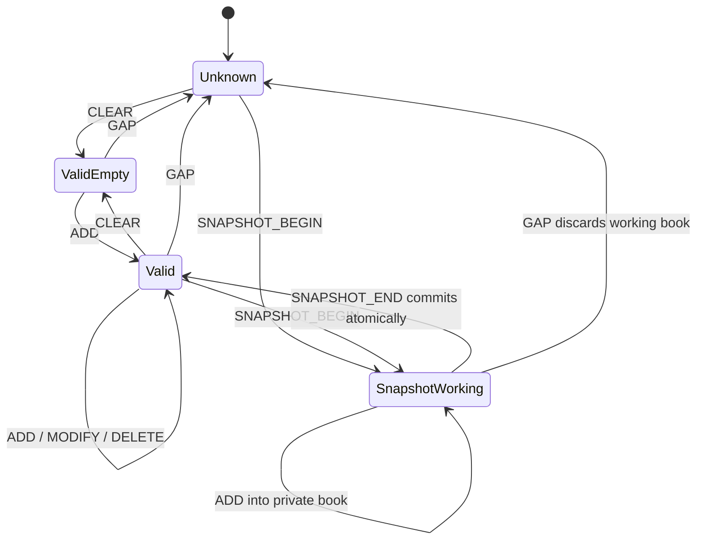

# Sequence, snapshots, gaps, and recovery

NWT has three independent notions of progress: `frame_seq` for transfer order, `sequence` for normalised publisher and channel output, and optional source-native gap endpoints. Never substitute one for another.

Types 1–9 carry the state described in the first sections. Types 10–22 add state of their own; see "State added in 1.1" below.

## MBO states

While an already valid book is being refreshed, the previous committed book may stay visible until the replacement snapshot commits. The working snapshot is never shown as complete. Applications should identify its age. A source GAP invalidates the committed state at once. CLEAR is a producer assertion of a valid empty source book. It is not a consumer shortcut for recovering unknown orders.

## Worked full-stream sequence (1.0 vector)

| Sequence(s) | Meaning |
|---|---|
| 1 | Equity definition establishes units and identity |
| 2–4 | NEW 42, correction referencing 2, cancel referencing 2 |
| 5 | Independent negative-price and fractional-quantity trade |
| 6–9 | Two-sided, one-sided, empty and crossed or indicative quotes |
| 10–11 | Nonempty and empty completed bars |
| 12–15 | MBO clear, add, modify, delete |
| 16–19 | MBO snapshot begin, bid add, ask add, end |
| 20–22 | Aggregate snapshot, empty snapshot, depth-limited snapshot |
| 23–28 | All trading-status enum values |
| 29–32 | Four source-gap reasons; all channel book and status state invalid |
| 33–34 | Quote and aggregate-depth recovery |
| 35–37 | MBO recovery snapshot and atomic commit |
| 38 | Status recovery |
| 39–42 | Heartbeat, info, warning, error |
| 43–49 | Remaining asset-class definitions |

The writer batches three records per DATA frame. The snapshot at sequences 16–19 crosses a frame boundary. Committing the frame that holds 16–18 does not publish a complete new book. Only sequence 19 commits it. The recovery snapshot also crosses frames. Event timestamps are deliberately not monotonic around BAR records. The frame timestamp bounds stay exact.

## State added in 1.1

| Type | State it keeps | Replaced or ended by |
|---|---|---|
| 10 VENUE_DEF | One record per `(publisher, mic)` | A later record with the same key |
| 11 OPTION_DEF | One record per `(publisher, instrument)` | A later record with the same key |
| 12 LISTING | One record per `(publisher, instrument)` | A later record with the same key |
| 13 STATISTICS | The latest SET per `(instrument, stat_type, ts_ref)` | DELETE for the same key |
| 14 OPTION_ANALYTICS | The latest analytics of the instrument | The next record |
| 15 BOOK_DELTA | Changes the aggregate book of BOOK_SNAPSHOT, one price level at a time | BOOK_SNAPSHOT replaces the book; GAP invalidates it |
| 16 IMBALANCE | The latest imbalance of the instrument | The next record |
| 17 SYMBOL_MAP | Symbol intervals per `(publisher, symbology, symbol)` | Intervals must not overlap, except for symbology 5 |
| 18 TRADE_QUOTE | None. It is a derived print | — |
| 19 BEST_QUOTE | Its own quote state, separate from QUOTE | The next record; GAP invalidates it |
| 20 FRAME_SUMMARY | None. It describes frames | — |
| 21 SECURITY_DEF | One record per `(publisher, instrument)` | A later record with the same key |
| 22 CORPORATE_ACTION | One record per `(publisher, unique_id)` | A later record with the same key |

### Aggregate book with deltas

BOOK_DELTA works on the same book as BOOK_SNAPSHOT. The book is valid after a BOOK_SNAPSHOT, or after a CLEAR with `side` 0. A delta against an invalid book is an error. SET adds a level or replaces its size and count. DELETE removes a level. CLEAR empties one side, or the whole book when `side` is 0. Levels are keyed by price, not by rank. `LAST_IN_EVENT` marks the last delta of one source event. A side never grows beyond 1024 levels, so the book can always be sent again as one BOOK_SNAPSHOT.

A GAP on a channel invalidates this book. The next BOOK_SNAPSHOT, or CLEAR with `side` 0, makes it valid again.

### Reference data

Reference records (types 10, 11, 12, 17, 21, 22) have publisher ≠ 0 and instrument 0 where the specification says so, and they do not need an INSTRUMENT_DEF. A later record replaces the earlier record with the same key. A reference record does not replace an INSTRUMENT_DEF, and the two do not have to agree on every fact. The exception is OPTION_DEF: when an INSTRUMENT_DEF exists for the same instrument, the asset class must be option, and the expiration, strike and underlying must match.

### Statistics

A statistic is a reference value, not a trade. `ts_ref` names the session or date it refers to. SET gives the value and DELETE withdraws it. A reader that keeps the latest SET per key and honours DELETE has the current statistics.

## Invalid examples

An unknown-order MODIFY is an error. A MODIFY that changes bid to ask is an error. A repeated live-order ADD is an error. A snapshot END without BEGIN is an error. A partial snapshot at normal END is an error. After a GAP, an ordinary ADD cannot prove the full MBO book is known: require CLEAR or a complete snapshot. A BOOK_DELTA on an invalid book is an error. A STATISTICS DELETE with a non-null value is an error. A SYMBOL_MAP interval that overlaps another for the same symbol is an error (symbology 5 excepted).

## Transfer failure versus source failure

A skipped `frame_seq` or a damaged CRC is a transfer failure. Stop strict decoding and retry from a trusted boundary. A contiguous, CRC-valid GAP record is a source failure notice. Transfer stays intact, but the affected market state is invalid. A recovery snapshot does not recreate missing trades and does not establish complete historical bars.

## Trade state

NEW, then zero or more CORRECT, then an optional CANCEL. Every CORRECT or CANCEL points to the NEW sequence. A canceled trade cannot be revived by CORRECT. NWT requires all referenced lifecycle records to be in the same container and channel. To export a correction-only time interval, include the needed earlier lifecycle context or reject that export.

## Selective reads, summaries and state

A reader that skips frames, for example with FRAME_SUMMARY records or an index, also skips the state those frames would have built. It is correct only for questions that do not depend on that state, such as trades of one instrument in a time range. A question about the current book, the current status, or the effect of a definition needs the frames that build that state, in original order. A store file does not change this. It makes the choice of frames faster, not the rules of replay. See [STORE.md](STORE.md).

## Application transaction boundary

Verify the raw CRC and the record structure of the whole frame before you claim integrity. Stage semantic changes and commit them only if all records pass. A multi-frame snapshot stays private across those commits until SNAPSHOT_END. For durable processing, tie the committed NWT position to your application state. A sequence number alone does not give exactly-once side effects.
