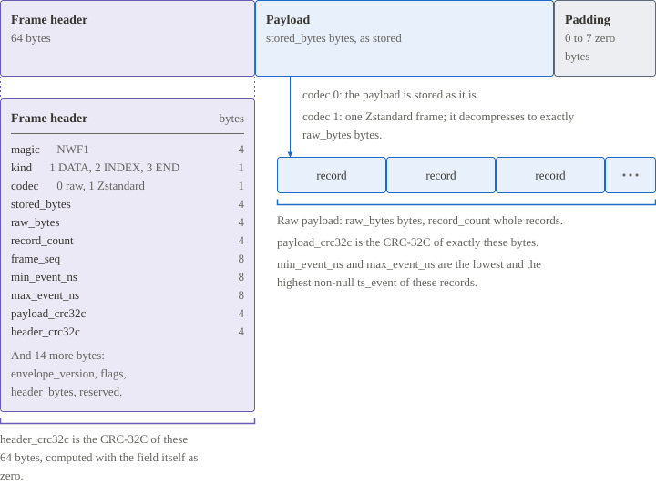

# Frames

A frame is the unit of integrity and the unit of compression. Its 64-byte header states the kind of the frame, the codec and the sizes of the payload, and it carries two CRC-32C values: one over the header and one over the raw payload. The payload of a `DATA` frame is stored as it is or as one Zstandard frame, so a reader decodes each frame on its own. A reader trusts a record only after the frame that holds it passes both checks.

[Specification: Frames](../specification/frames.md) · [Specification: Compression and integrity](../specification/compression-and-integrity.md)
