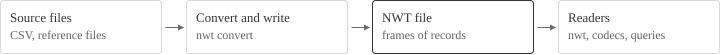

# From source to reader

A converter maps the rows of a source file to records, and a writer packs the records into one container. The same container serves as a file and as a live stream. A reader validates the container, decodes it in full, or reads only the frames that a query needs.

[Use NWT in practice](../USE-CASES.md) · [The nwt command](../TOOLS.md) · [Implementation guide](../IMPLEMENTATION-GUIDE.md)
