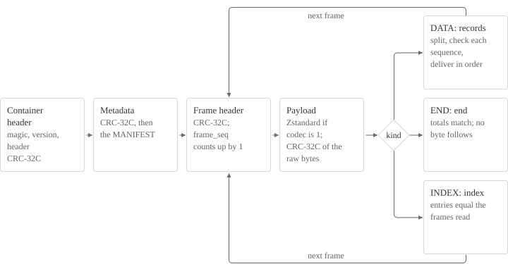

# Read a file

A reader validates a container in this order. `Reader.scan` in the Python codec follows the same steps.



1. Read the 64-byte container header. Check the magic `NWTBIN\r\n`, `major` 1, `minor` 0 or 1, the header length 64, the header CRC-32C, the reserved bytes and a stream ID that is not all zero.
2. Read the metadata. Check its length and its CRC-32C, split it into TLV elements and validate the `MANIFEST`. `minor` is 1 exactly when the manifest declares any record type 10–22.
3. Read each 64-byte frame header. Check its CRC-32C, the magic `NWF1`, the kind (`DATA`, `INDEX` or `END`), the codec, both sizes against the 16,777,216-byte maximum, and that `frame_seq` counts up from 0 without a hole.
4. Read the stored payload and its padding. For a Zstandard frame, check the Zstandard frame header and decompress to exactly `raw_bytes`. Check the payload CRC-32C over the raw payload.
5. For a `DATA` frame, split the payload by `record_bytes`. Check the record count, the sequence of each record within its publisher and channel, that the manifest declares the type and the publisher of each record, and that the time bounds of the frame equal the lowest and the highest non-null `ts_event`. Decode the records.
6. For `INDEX` frames, check that the entries equal the ones you computed from the `DATA` frames. For `END`, check the totals, the index offset and the status, and that nothing follows `END`.
7. Report a file that ends before `END` as incomplete, and a container whose `END` status is 1 as aborted.

The result is the decoded records in file order. A record is returned only after its frame has passed every check.

<!-- nwt-tabs -->
<!-- nwt-title: Python -->
```python
import sys
sys.path.insert(0, "examples/python")
import nwt_example as nwt

with open("fixtures/real-market/equity-quotes.nwt", "rb") as f:
    reader = nwt.open_reader(f)                  # header, metadata and manifest are checked here
    trades = 0
    for record in nwt.complete_records(reader):  # a frame is checked before its records are returned
        if record["type"] == 18:                 # TRADE_QUOTE
            trades += 1
    print(trades, "TRADE_QUOTE records;", reader.end["total_records"], "records in all")
```
<!-- nwt-title: Rust -->
```rust
let ss: Schemas = serde_json::from_str(SCHEMA)?;
let mut reader = Reader::new(BufReader::new(File::open("work/python.nwt")?), &ss)?;
let mut trades = 0u64;
complete_records(&mut reader, &ss, |r| {
    if r.r#type == 1 {
        trades += 1;
    }
    Ok(())
})?;
println!("{trades} TRADE records");
```
<!-- nwt-title: C# -->
```csharp
using var input = OpenRead("work/python.nwt");
int trades = 0;
foreach (var r in Records(OpenReader(input)))
    if (r.type == 1)
        trades++;
Console.WriteLine($"{trades} TRADE records");
```
<!-- nwt-title: C++ -->
```cpp
Reader rd;
rd.open_file("work/python.nwt");
std::size_t trades = 0;
rd.scan(true, [&](const FrameInfo &, const std::vector<View> &, std::vector<Rec> &recs) {
  for (const auto &r : recs)
    if (r.type == 1)
      trades++;
});
need(rd.end.status == 0, "aborted container");
std::cout << trades << " TRADE records\n";
```
<!-- /nwt-tabs -->

The Python fragment is a complete program that imports the codec as a module. It reads the sample [equity-quotes.nwt](files/samples/equity-quotes.nwt) and prints:

```text
476 TRADE_QUOTE records; 2477 records in all
```

The Rust, C# and C++ codecs are single-source programs. Their fragments use the functions of that source and go inside it, for example as a new command next to `read`. On `work/python.nwt` each prints `1 TRADE records`.
