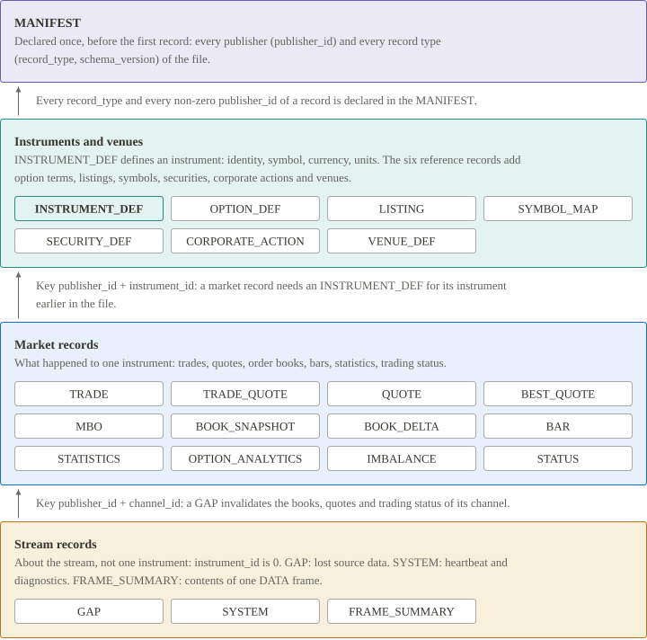

# Record types

The format defines 22 standard record types. Each type has its own page with its fields and rules, linked from the table below.

| Type | Name | Record bytes | Purpose |
|---:|---|---|---|
| 1 | [`TRADE`](../records/TRADE.md) | 88 | Trade lifecycle |
| 2 | [`QUOTE`](../records/QUOTE.md) | 96 | Replacement of the top of book |
| 3 | [`BAR`](../records/BAR.md) | 112 | Completed time bucket |
| 4 | [`MBO`](../records/MBO.md) | 88 | Change of one order in the book, and snapshot markers |
| 5 | [`BOOK_SNAPSHOT`](../records/BOOK_SNAPSHOT.md) | 56 + 48 × levels | Replacement of the aggregate depth |
| 6 | [`INSTRUMENT_DEF`](../records/INSTRUMENT_DEF.md) | align8(112 + text) | Interpretation of an instrument |
| 7 | [`STATUS`](../records/STATUS.md) | 64 | Trading status |
| 8 | [`GAP`](../records/GAP.md) | 80 | Discontinuity at the source |
| 9 | [`SYSTEM`](../records/SYSTEM.md) | align8(64 + text) | Heartbeat or diagnostic |
| 10 | [`VENUE_DEF`](../records/VENUE_DEF.md) | align8(96 + text) | Trading venue or segment, with its market identifier code |
| 11 | [`OPTION_DEF`](../records/OPTION_DEF.md) | align8(96 + text) | Terms of an option contract |
| 12 | [`LISTING`](../records/LISTING.md) | align8(72 + text) | Symbol-directory listing of one instrument |
| 13 | [`STATISTICS`](../records/STATISTICS.md) | 80 | Open, high, low, close, settlement, VWAP, volume, open interest |
| 14 | [`OPTION_ANALYTICS`](../records/OPTION_ANALYTICS.md) | 120 | Implied volatility and Greeks |
| 15 | [`BOOK_DELTA`](../records/BOOK_DELTA.md) | 72 | Change of the aggregate book at one price level |
| 16 | [`IMBALANCE`](../records/IMBALANCE.md) | 104 | Auction imbalance |
| 17 | [`SYMBOL_MAP`](../records/SYMBOL_MAP.md) | align8(72 + text) | Symbol valid for an instrument over a time interval |
| 18 | [`TRADE_QUOTE`](../records/TRADE_QUOTE.md) | 120 | One trade with the top of book immediately before it |
| 19 | [`BEST_QUOTE`](../records/BEST_QUOTE.md) | 112 | Best bid and offer with the venue of each side |
| 20 | [`FRAME_SUMMARY`](../records/FRAME_SUMMARY.md) | 104 | Summary of one frame for selective reads |
| 21 | [`SECURITY_DEF`](../records/SECURITY_DEF.md) | align8(216 + text) | Security-master record for one listing |
| 22 | [`CORPORATE_ACTION`](../records/CORPORATE_ACTION.md) | align8(184 + text) | One corporate-action event |

The layouts of all record types are available as a machine-readable schema: [records.json](files/records.json). The entry for `TRADE` looks like this:

<!-- nwt-file: schemas/records.json lines=116-175 -->

## Common rules

- Every standard schema uses `schema_version` 1.
- Offsets in the layout tables are counted from the start of the record. The body starts at offset 48, after the [record header](record-header.md).
- Prices, quantities and counts follow [Decimal values and null values](data-types-and-conventions.md#decimal-values-and-null-values). In the tables, "null allowed" means the null value of the type marks an unavailable fact.
- Reserved bytes are zero.
- An enum value that is not assigned and a flag bit that is not assigned are invalid.

**Text fields.**

- Each text has a `u16` length field in the fixed part of the record. The length counts bytes.
- The texts follow the fixed part in the order of their length fields, with no separators. Zero padding then fills the record to a multiple of 8 bytes.
- A length outside the stated range is invalid. A writer checks the range before it writes a length.
- Text is UTF-8 without NUL. See [Text](data-types-and-conventions.md#text).

## Scope and required schemas

The record type decides which values the header fields `publisher_id` and `instrument_id` take.

| Class | Record types | Header scope |
|---|---|---|
| Market record | `TRADE`, `QUOTE`, `BAR`, `MBO`, `BOOK_SNAPSHOT`, `STATUS`, `STATISTICS`, `OPTION_ANALYTICS`, `BOOK_DELTA`, `IMBALANCE`, `TRADE_QUOTE`, `BEST_QUOTE` | Publisher ≠ 0 and instrument ≠ 0. An `INSTRUMENT_DEF` for the instrument comes earlier in byte order |
| Definition | `INSTRUMENT_DEF` | Publisher ≠ 0 and instrument ≠ 0 |
| Reference record | `OPTION_DEF`, `LISTING`, `SYMBOL_MAP`, `SECURITY_DEF`, `CORPORATE_ACTION` | Publisher ≠ 0 and instrument ≠ 0 |
| Reference record | `VENUE_DEF` | Publisher ≠ 0 and instrument = 0 |
| Control record | `GAP` | Publisher ≠ 0 and instrument = 0 |
| Control record | `SYSTEM` | Instrument = 0. Publisher 0 with channel 0, or a declared publisher |
| Control record | `FRAME_SUMMARY` | Publisher 0, channel 0 and instrument 0 |

- For `TRADE`, `QUOTE`, `BAR`, `MBO`, `BOOK_SNAPSHOT`, `INSTRUMENT_DEF` and `STATUS`, the channel ID and the publisher of the instrument agree with the stream context.
- A reference record needs no earlier `INSTRUMENT_DEF` and does not replace one.
- A reference record replaces an earlier record of the same type and identity. The identity of each type is stated on its record page.

The manifest declares each schema with a `required` value.

| `required` | Record types |
|---|---|
| Always true | `MBO`, `BOOK_SNAPSHOT`, `INSTRUMENT_DEF`, `STATUS`, `GAP`, `BOOK_DELTA` |
| Always false | `FRAME_SUMMARY`, so that a reader that does not know it can skip it |
| Chosen by the producer | Every other standard record type, according to the contract with the consumer |
