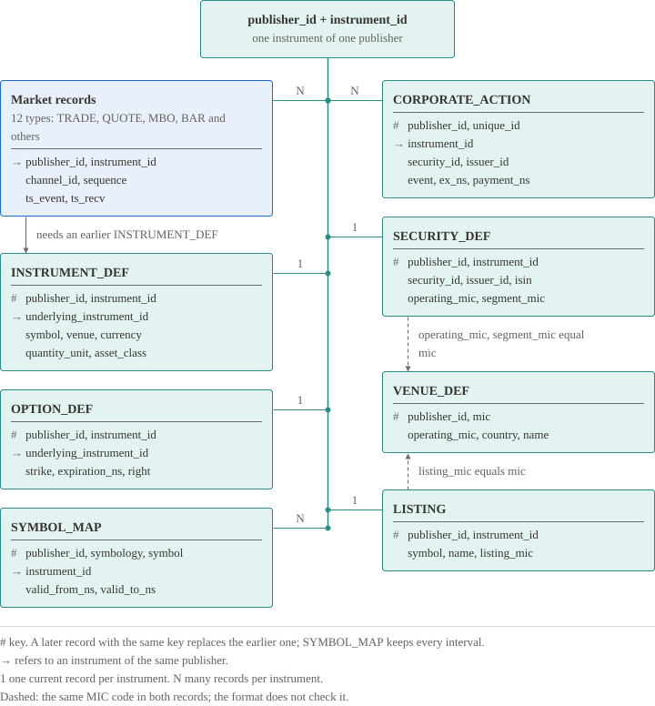

# State a consumer keeps

A consumer starts with no state: every order book, quote and trading status is unknown. Each record then creates, replaces or ends one piece of state. The key is the set of fields that identifies that piece.

| Record type | State | Key | Replaced or ended by |
|---|---|---|---|
| `INSTRUMENT_DEF` | Definition of an instrument: identity and units | Publisher, instrument | A later definition with the same key. Its currency and quantity unit stay the same. |
| `TRADE` | Lifecycle of one trade | Publisher, channel, instrument, `trade_id` | `CORRECT` replaces the values; `CANCEL` ends the trade. |
| `QUOTE` | Top of book | Publisher, channel, instrument | The next `QUOTE`; `GAP` invalidates it. |
| `BAR` | Set of completed bar intervals | Publisher, channel, instrument, interval | Nothing. A second bar for the same interval is an error. |
| `MBO` | Order-level book | Publisher, channel, instrument | `CLEAR` or a completed snapshot; `GAP` invalidates it. |
| `BOOK_SNAPSHOT`, `BOOK_DELTA` | Aggregate book: price levels on each side | Publisher, channel, instrument | The next `BOOK_SNAPSHOT`; `GAP` invalidates it. |
| `STATUS` | Trading status | Publisher, channel, instrument | The next `STATUS`; `GAP` invalidates it. |
| `GAP` | Recovery IDs seen so far | Container | The end of the container. |
| `VENUE_DEF` | Venue | Publisher, `mic` | A later record with the same key. |
| `OPTION_DEF` | Terms of an option contract | Publisher, instrument | A later record with the same key. |
| `LISTING` | Listing of an instrument | Publisher, instrument | A later record with the same key. |
| `STATISTICS` | Latest value of one statistic | Publisher, channel, instrument, `stat_type`, `ts_ref` | The next `SET`; `DELETE` withdraws it. |
| `OPTION_ANALYTICS` | Latest analytics of an option | Publisher, channel, instrument | The next record. |
| `IMBALANCE` | Latest auction imbalance | Publisher, channel, instrument | The next record. |
| `SYMBOL_MAP` | Validity intervals of a symbol | Publisher, `symbology`, symbol | Nothing. Intervals of one symbol do not overlap. |
| `BEST_QUOTE` | Best quote, separate from the `QUOTE` state | Publisher, channel, instrument | The next `BEST_QUOTE`; `GAP` invalidates it. |
| `SECURITY_DEF` | Security master record | Publisher, instrument | A later record with the same key. |
| `CORPORATE_ACTION` | Corporate action | Publisher, `unique_id` | A later record with the same key. |

`SYSTEM`, `TRADE_QUOTE` and `FRAME_SUMMARY` carry no state. A `TRADE_QUOTE` is a trade print together with the quote at that moment; it changes neither the trade lifecycle nor the `QUOTE` state.

A market record needs an `INSTRUMENT_DEF` for its publisher and instrument earlier in the container. The market record types are `TRADE`, `QUOTE`, `BAR`, `MBO`, `BOOK_SNAPSHOT`, `STATUS`, `STATISTICS`, `OPTION_ANALYTICS`, `BOOK_DELTA`, `IMBALANCE`, `TRADE_QUOTE` and `BEST_QUOTE`. The layouts and field rules of every type are in the [Specification](../specification/record-types.md).
