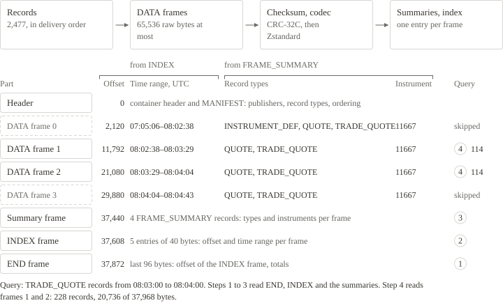

# What the store profile is

The store profile is a set of choices a writer makes. It is not a second format: a store file has the same container header, the same frames and the same records as any other NWT file, and every NWT reader reads it from the first byte to `END`. A reader that knows the profile answers a query by reading only the frames that can hold a match.

| Setting | Value in a store file | Purpose |
|---|---|---|
| Frame size | 1,048,576 bytes of raw payload by default; at most 16,777,216 | Fewer frame headers, better compression, fewer reads |
| Compression | Zstandard, level 3 by default. A frame that does not shrink is stored raw. | Smaller files |
| `INDEX` | Always written | One entry per `DATA` frame: offset, lowest and highest `ts_event`, raw size and record count |
| `FRAME_SUMMARY` | Always written | Per frame: the record types it holds, the lowest and the highest instrument ID, the stored size and the codec |
| `ordering` | Declared in the manifest when it holds | States that the records are in `ts_event` order, or in instrument and then `ts_event` order |

Records are never reordered. Byte order is the delivery order, and definitions, snapshots and trade corrections depend on it. Writing a store file changes the framing and the compression, and nothing else about the records.

Zstandard frames need the system [libzstd](https://github.com/facebook/zstd) (Python, C#, C++) or the [zstd](https://github.com/gyscos/zstd-rs) crate (Rust). Raw frames need no library. The Specification defines the profile in [Store profile](../specification/store-profile.md).
